---
output:
  html_document:
    keep_md: true

title: "Buddhism and Action: What the Dharma Trains, and What It Leaves Open"
date: 2026-11-04
permalink: /posts/2026/11/buddhism-and-action/
tags:
  - snippets
---

Buddhism excels at teaching us to loosen our grip on views and our entanglement in the push-and-pull struggle with experience. This post is about what that leaves open. My starting point is a simple question: what does an individual need in order to act, and to act well? The question can, but need not, extend to acting for the world at large, since an individual’s conditions include other people and the world.

## TL;DR

This post is about taking action, examined through a Buddhist lens – specifically the insight practice most Western practitioners meet, read through Madhyamaka. It makes a conceptual argument about the nature of taking action – that it requires clinging – and then asks where guidance on how to act can come from, given that Buddhism (for good reasons, which I'll spell out) offers values and orientation but no method for deciding between concrete courses of action. It argues for four claims.

(1) Taking any action requires solidifying, and clinging to, a view of oneself, one’s conditions and what one wants. Without any clinging there is no impetus to act; freedom from the push-and-pull is always a matter of degree, never absolute, for beings that must act in order to survive. Many Buddhists hold that a view seen as empty can be acted on without such solidification. I argue that solidification begins with perception itself, which selects one model of the world over others, and that acting on a view likewise means selecting it over alternatives. Selection is already solidification, and seeing a view as empty doesn’t undo it. Even those who disagree grant that anyone short of awakening – nearly all of us – cannot act without some clinging; for us, it is needed.

(2) Wise action may require not just some but *strong* clinging: felt intensity is fuel, and a practice that reflexively cools it may under-supply what wise action needs; and living among others, with their different wants, and the asymmetries of will and power between them, demands holding one's view amidst theirs.

(3) Buddhism offers substantial ethical guidance – values such as compassion and non-harm, rules such as the precepts – but it cannot settle what to cling to: which views, which desires and, most importantly, which trade-offs to make when those values and rules pull in different directions. What it leaves open follows from the question it set out to answer: how suffering arises in the mind’s *relation* to circumstances, and how it ceases. The target is the relation, not the circumstances themselves, which is why its guidance is about how to *hold* a situation, far more than about *which* situation to bring about. This division of labour deserves more recognition. It means the content of concrete wise action must come from many sources: psychology and psychotherapy, rationality and the sciences, politics, lived experience.

(4) Gathering and integrating that content is hard: bubbles stand in the way at every level, from the blind spots of one's own mind to those of whole communities, and behind them a pull, in every community, toward complete answers from a single source. Current integration attempts are limited: the Buddhist frameworks that integrate action and desire into practice leave open *which* actions, *which* desires and what *trade-offs*; Integral Altruism, which sets out to integrate Buddhism, Effective Altruism, complexity science and more into *actionable* insight, has yet to show that anything unique emerges rather than an additive sum of its sources. Often the better (and more manageable) aim may be fluency in several approaches and choosing, case by case, what fits, singly or in combination. That choosing is itself a skill no framework supplies: it is trained by starting from the contexts one is actually embedded in, testing responses there, and seeing whether things actually shift.

Finally, the post ends by proposing a *cycle of action* and clarifying Buddhism’s role in it: loosening one's grip on views to assess, drawing on as many perspectives as one can reach; then solidifying, clinging, at times strongly, to act; loosening again when conditions change. Buddhism’s contribution in the two halves is not symmetric – it trains the loosening like nothing else, but by construction has much less to say about the other half; its content must be brought in from elsewhere. That makes Buddhism a natural starting point. The danger lies where Buddhist communities take it for more than that: as complete guidance for acting/living, and/or as justification for non-action.

**A note on scope.** By “Buddhism” I mean, throughout, the Buddhism most Western practitioners meet: insight practice as it came to the West through teachers trained in Theravāda monasticism – the lineage of the Insight Meditation Society, Gaia House and their offshoots – read philosophically through Madhyamaka, mainly as Rob Burbea taught it. That is where my own practice and reading come from, and it is a Western lens, not a universal one. Other traditions work differently with what this post is about. Mahayana teachings put collective liberation and the bodhisattva’s activity in the world at their centre, and Vajrayana works with intense emotions such as desire and anger as fuel to be transformed rather than cooled – an ally, in that respect, of the second claim above. Where other strands of Buddhism say more about action – the rules of the early texts, Mahayana’s skilful means, Vajrayana’s work with intensity, Dzogchen’s spontaneous presence – I note it along the way.

## Table of contents
* [I. Action Requires Clinging](#action_requires_clinging)
	* [Solidification of a View Enables Action](#solidification)
	* [Emptiness, Awakening, and Clinging](#emptiness_awakening_clinging)
	* [Reactivity, Clarity, and Fuel](#reactivity_clarity_fuel)
	* [Strong Clinging Among Others](#strong_clinging_among_others)
* [II. What to Cling to Must Come from Elsewhere](#what_to_cling_to)
	* [What Buddhism Leaves Open](#what_buddhism_leaves_open)
	* [Individual Wellbeing – Insights From Psychotherapy](#individual_wellbeing)
	* [Collective Well-being – Insights From Rationality](#collective_wellbeing)
	* [Doesn’t Engaged Buddhism Address Collective Flourishing?](#engaged_buddhism)
	* [Why Drawing on Many Approaches and Perspectives Is Tough](#many_approaches)
	* [Integration Frameworks – and the Open Half of the Cycle](#integration_frameworks)
* [III. Deconstructing To Reconstruct: The Cycle Of Spacious Viewing And Focused Action](#deconstructing_to_reconstruct)
* [Concluding Words](#concluding_words)
* [Coda: No End-States](#coda)
* [Acknowledgements](#acknowledgements)
* [References](#references)

<figure class="landscape">
  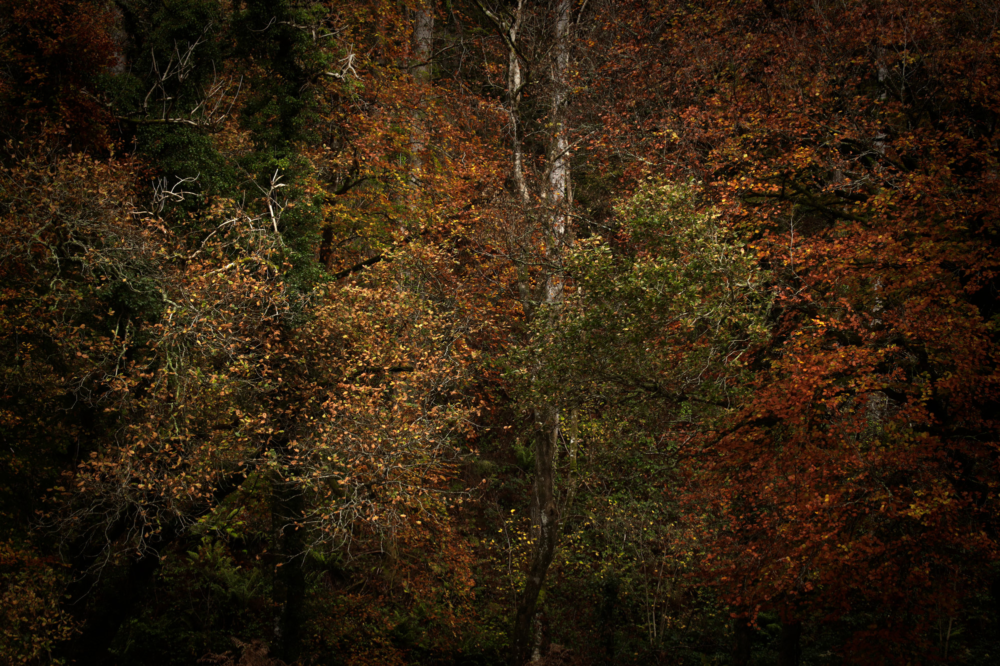
  <figcaption>
    Along the River Avon. (CC-BY-SA 4.0)
     
  </figcaption>
</figure>

## I. Action Requires Clinging 

### Solidification of a View Enables Action 

What does it take to act – and what does Buddhist philosophy make of it?

Acting and the solidification of a view are deeply related. By “view” I mean, throughout this post, any way of seeing and interpreting – a necessarily partial representation of oneself (“I am someone who…”), of a situation (“these are my options, this is what’s at stake…”), or of the world. Views range from momentary framings to entire (more stable) worldviews.

Madhyamaka Buddhism[^1], in Rob Burbea's presentation of it, focuses on loosening our sense of solidity around views, including the concept and sense of self, arguing that ultimately, everything is *empty* (including the very notion of emptiness). The idea of emptiness, in brief: there is no absolute, objective truth. Any “truth” is bound to a particular perspective and a simplification of reality, always falling short of fully acknowledging the conditionality of phenomena (what the tradition calls *dependent origination*[^2]). It is thus ultimately empty – not capturing the thing it relates to fully. We should therefore loosen our grip on views; take any view lightly, with as much flexibility to change views as possible, according to what’s “useful” at any point in time. (This view on truth is, of course, also just a view – arguably a better one, but one that will not capture truth entirely either.)

Loosening our sense of solidity around views is a good call, as people tend to be rather entangled in, and suffering from, too much solidification of views, or what one might call *selfing*. But it can’t stop there. We do need to work with *some* views, and *some* sense of self, in order to act. Solidification of a view is a prerequisite for taking action.

What does solidifying a view involve? It begins earlier than any deliberate, conscious choice: with perception itself. Perception, as the neuroscientist Anil Seth argues in [Being You](https://www.anilseth.com/being-you/), his book on the science of consciousness, is a “controlled hallucination”: the brain’s best guess about the causes of its sensory signals – a model it constructs, not a readout of the world as it is. Ambiguous pictures make this visible: in the duck–rabbit drawing we see a duck or a rabbit, never both at once. The brain selects one model and, for the moment, treats it as the world.[^3] That is what I mean by solidification: treating one partial model as reliable enough to go on, at the expense of the alternatives. Two constraints make it unavoidable. Without some model, however light or flexible, there would be no perception and no action at all. And a being bounded in space, time and attention can only ever hold a few models at once, never all possible ones, so selection is going on all the time: settling, moment by moment, on one percept, one view, one course of action over the others available. This continuous selection is what the rest of Part I turns on. Clinging to a given selection comes in degrees, since it can be held tightly or loosely. Solidification is already at work before we “do” anything at all.

When we do act, the same holds – even for the simplest action there is: lifting your arm. According to one influential, though not settled, theory in neuroscience, [*active inference*](https://directory.doabooks.org/handle/20.500.12854/84566), the brain moves the arm by predicting the movement – “my arm is rising” – and the body then makes that prediction come true; the prediction is, in effect, the intention. For this to work, the brain has to stick with its prediction even though, at that moment, the arm still feels at rest. If it trusted what it currently feels – the arm at rest – over what it predicts, it would simply correct the prediction to “my arm is at rest”, and nothing would move ([Brown et al., 2013](https://link.springer.com/article/10.1007/s10339-013-0571-3)). Whether or not active inference proves right in its details, the point it illustrates is hard to avoid: even the simplest action requires committing to one model of what is about to happen, and holding it firmly enough to carry it through. [Laukkonen and Slagter (2021)](https://research.vu.nl/en/publications/from-many-to-nonemeditation-and-the-plasticity-of-the-predictive-/) read meditation as the gradual loosening of exactly this grip, in perception and action alike, with the cessation of experience as its limit.

Most of what we call action is more than a movement: it involves deciding. A mundane example: when I ponder whether or not to go to a coffeeshop within the next hour, I at least need a sense of self as a boundaried entity; I can’t be in a state of relative ego dissolution where the “I” disappears, because taking an action requires a sense of being a “someone” who takes it.[^4] I also need a view on the conditions I find myself in, to then reason about what to do given those conditions: Should I have a third coffee today, or is that unhealthy? I’m tight on time and should finish my GitHub pull request before the end of the day. But the nearby coffeeshop genuinely gives me good energy, and I might need that today. All of this reasoning is incomplete, distorted, and contingent on the entirety of my history; any view is necessarily partial. And yet without solidifying some view – of myself, my conditions, what I want – no action, however small, gets taken.

Perception, a lifted arm, a coffee: the scale grows, but the structure stays the same – one view is selected and relied on over others. The same is true further up: in standing one’s ground in an argument, or in a political movement that will not let go of its cause. These sit on one continuum, from the subtle, mostly inconsequential fixing that perception and small acts involve to the gross, palpable, fiery kind.

Not everything that looks like “acting” belongs on this continuum. A robot vacuum turning at a wall also follows a model, and from the outside may behave much like an animal doing the same; but nothing is at stake for it, since it does not have to stay alive. Nor does every movement of a living body count: a reflex, or the twitch of a body that has just died, happens without anything being perceived or done. My claim concerns perception and action in living beings, which have to keep perceiving and acting in order to stay alive.

<figure class="landscape">
  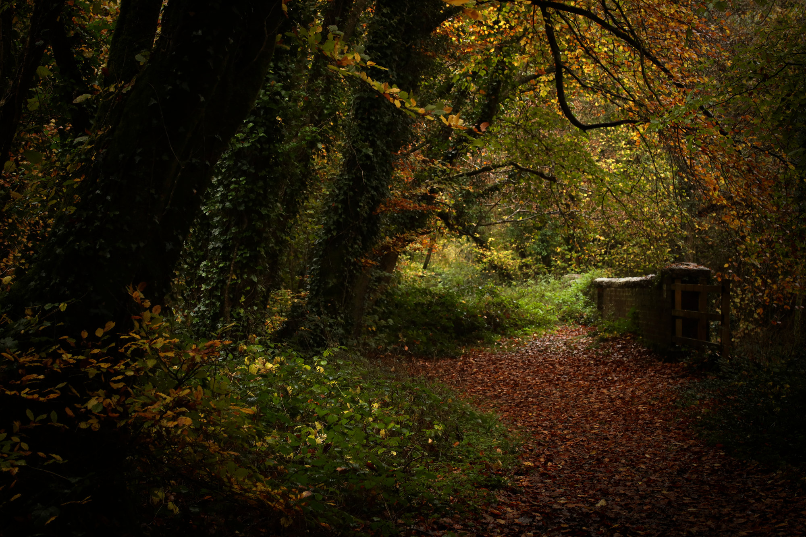
  <figcaption>
    Along the River Avon. (CC-BY-SA 4.0)
     
  </figcaption>
</figure>

### Emptiness, Awakening, and Clinging 

In Buddhist discussions, solidification usually means something stronger than what I mean by it: taking a view to be real – losing sight of its emptiness. On that reading, two familiar points follow: a view seen as empty – recognised as a construction – can guide perception and action without being solidified; and, as the middle way holds, views are neither fully real nor unreal, and remain relevant to action even when seen as empty. Both points are right, and neither touches what I mean. Solidification in my sense does not require taking a view to be real, only selecting it and relying on it. A view seen as empty, if it guides perception or action, has still been selected and relied on over the alternatives – the duck rather than the rabbit, “my arm is rising” rather than “my arm is at rest”. Seeing its emptiness changes how tightly it is held, not whether it is selected and relied on.

The potential disagreement lies elsewhere. Dzogchen describes awakened action as “spontaneous presence” (*lhun grub*): responsive and precise – the tradition even speaks of a discriminating wisdom that discerns each situation – yet free of any conceptual fixing. On my account, both constraints still apply. However light and flexible, some model must be in play, or there would be nothing to respond to and no response; and a being who acts this way still holds some views and not others, its response one among many it might have made. Only a being free of both – working from no model at all, or holding all possible views at once, as some traditions say of a buddha – would escape solidification.[^5] I doubt such a being is possible, and that is where I part ways with these traditions.

<figure class="landscape">
  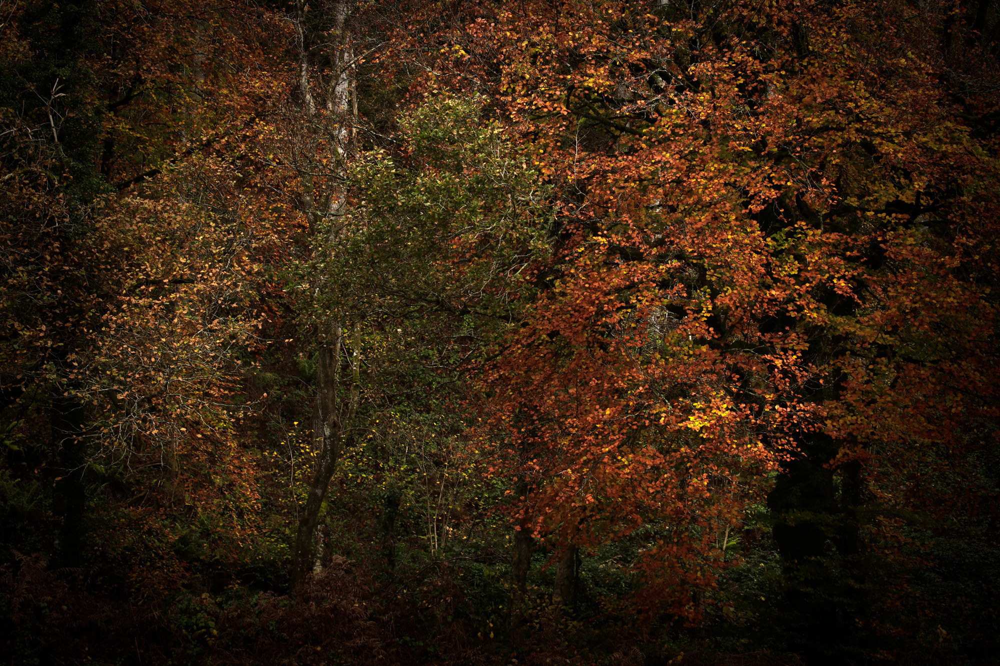
  <figcaption>
    Along the River Avon. (CC-BY-SA 4.0)
     
  </figcaption>
</figure>

Solidifying a view always brings some investment with it. Once one model has been relied on rather than others, there is a *stake*: something can now go wrong, and something has been given up. I will call this investment *clinging*, and use the word broadly: the solidifying of a view, a desire or a motivation, together with the stake it creates. Solidification and clinging thus always come together, in different degrees. This broad use cuts across the tradition’s own terms. *Taṇhā* is craving, the thirst at the root of suffering; *upādāna* is clinging in the narrower sense of grasping at, and identifying with, what is craved; *chanda* is wholesome desire – the wish to act well, which the Buddha treated as indispensable to the path (see Ajahn Jayasaro’s essay on the [teaching of effort](https://www.lionsroar.com/just-do-it/)). I don’t equate chanda with clinging; I take chanda to involve it, usually in milder form. This is also why I don’t accept the claim, made in one form or another by most traditions, that an awakened being acts without clinging – from chanda alone, in the early texts’ terms. They mostly grant that an awakened being still perceives, intends and chooses; what they deny is that it grasps at or identifies with anything (see Box 1 below). But grasping and identifying are not, I think, an extra act added on top of perceiving and acting. To perceive and act at all, a being that must survive has to keep settling on one percept, view or course of action rather than others; each such settling creates a stake; and to have a stake in a view is already to grasp at it and identify with it, however faintly. Grasping, identifying, clinging: three words for the same thing. What varies is intensity and flexibility – how strongly a view is held, how readily it is revised, how much it can hold – not the presence or absence of clinging. I take the difference to be one of degree, not of kind.

All of this is close to Burbea’s own position. In [Seeing That Frees](https://hermesamara.org/seeing-that-frees) he argues that perception itself requires a degree of clinging, and that phenomena appear more or less solid along a continuum as clinging fades: world and clinging co-arise, and not even awareness stands outside this.[^6]

Box 1: Can an awakened being act without clinging?

I’ve argued that it can’t: to perceive and act at all, a living being has to keep settling on one percept, view or course of action over others, and each such settling creates a stake – some clinging, however faint. Most Buddhist traditions disagree. None denies that awakened beings perceive and act; each locates clinging somewhere that perceiving and acting don’t require. Where they locate it shows where, and how far, we part ways.

<em>Theravāda</em>. For the early texts, awakening is not clinging worn down to a minimum but clinging cut off: the remaining fetters, the conceit “I am” among them, are abandoned, “cut off at the root, made like a palm stump”, unable to grow back. What continues are the five aggregates – body, feeling, perception, intention, consciousness – but no longer as “aggregates subject to clinging” (SN 22.48). An arahant still feels bodily pain and responds to it; what is gone is the second, mental pain that the untrained mind adds to the first (SN 36.6, the simile of the two arrows), along with the habit of regarding anything as “this is mine, this I am, this is my self”. The Abhidhamma accordingly classes an arahant’s intentional acts as merely “functional”: they arise, but leave no karmic trace. On this view, the stake I describe belongs to the first arrow, which no living being escapes; clinging is the second, which can end. I think a faint second arrow comes with every first.

<em>Gelug Madhyamaka</em>. Tsongkhapa’s school distinguishes three things. Grasping at things as inherently existent is the root of suffering, and an arahant has abandoned it. But even an arahant’s mind, outside deep meditation on emptiness, still makes things appear inherently existent – an appearance no longer believed, but not yet gone. Only a buddha is free of it, and only a buddha knows conventional and ultimate truth at once; everyone else alternates between them, much like the cycle of loosening and solidifying in Part III. What no one loses is valid conventional cognition – knowing a cup as a cup – through which a buddha acts for others. Of the traditions here, this one comes closest to my view: for every being short of buddhahood, it grants a residue of solidity in every ordinary perception. We differ on two points. The Gelug don’t call that residue clinging: it is a stain on how things appear, not a grasping, and causes no suffering. I suspect it does carry a stake, and so some clinging – and with it, perhaps, some faint suffering. Moreover, they hold that buddhahood, in which the residue is gone and conventional knowing continues, is real – that is the being whose possibility I doubt. (Other Tibetan schools, such as the Nyingma and Kagyu, draw these lines differently. For an accessible account of Tsongkhapa’s view, see Guy Newland’s Introduction to Emptiness.)

<em>Chan and Zen</em>. Here the decisive line runs between a mind that moves and a mind that stops. The Platform Sūtra traces Huineng’s awakening to the Diamond Sūtra’s line “give rise to a mind that abides nowhere”, and makes non-abiding the basis of practice: thoughts arise, but the mind does not settle into them. Takuan Sōhō, writing to a sword master, makes it concrete. If the mind stops on the opponent’s blade, “your own movements will be undone”; “glancing at something and not stopping the mind is called immovable”; and “the mind of attachment arises from the stopping mind.” On this view, seeing the blade and answering it is not clinging; stopping on it is. The duel is a fair test of my view, since survival is literally at stake. I’d say that answering this strike rather than another is already a settling with a stake, however briefly held; Zen would say the stake is there, but nothing is held.

<em>Dzogchen</em>. Dzogchen distinguishes ordinary mind (sems), which grasps at subject and object, from rigpa, the open, knowing awareness that is mind’s nature. Once rigpa is recognised, thoughts and perceptions go on arising as its display, but they free themselves as they arise, like a drawing on water that vanishes as it is drawn. Nothing has to be let go of, because nothing was taken up; action from there is the spontaneous presence discussed in the main text. The account rests on rigpa being unconditioned – an awareness not itself constructed, from which responses can arise without being fixed. That is where I part ways: with Burbea and Avigur (footnote 6), I doubt there is any awareness standing outside the play of construction. And a drawing on water is still a drawing: one line was drawn rather than another.

<em>Buddha-nature teachings</em>. The Ratnagotravibhāga goes furthest. It pictures a buddha’s activity through nine images: a drum of the gods that sounds with no one playing it, rain clouds that water every field without intending to, a sun that lights everything without meaning to. Each being receives what it is ready for; the fitting is done by conditions, not by a buddha choosing. This is what the main text calls working from no model at all – just as Gelug omniscience is holding all views at once.

Across all of these, the question is the same: can clinging end while perceiving and acting go on? Each answers yes. I think the only way to be entirely free of it is to stop perceiving and acting altogether – which, for a living being, means death.

Two things follow. In principle, freedom from clinging is always a matter of degree for a being that has to act in order to survive – and survival is the ultimate stake beneath all the smaller ones: to stay alive, we must keep perceiving and acting, and so keep solidifying. Meditation can give us a break from the push-and-pull and make room for a wiser, more skillful kind of clinging. But complete freedom from clinging would mean no longer perceiving or acting at all, and a being in that state would not live for long. In practice – and this matters more for what follows – even those who reject the in-principle claim grant that anyone short of awakening, nearly all of us, cannot act without some clinging. For us, practices aimed at loosening can damp the fuel that action needs, and the damping can be mistaken for wisdom. That risk grows towards the larger end of the continuum sketched above – away from the coffee, towards the decisions that shape a life: what to do in life, which work to take on, how to stand up for one’s values. That end is what the rest of this post is mostly concerned with.[^7]

<figure class="landscape">
  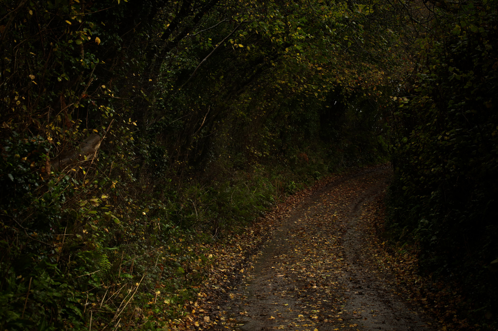
  <figcaption>
    Along the River Avon. (CC-BY-SA 4.0)
     
  </figcaption>
</figure>

### Reactivity, Clarity, and Fuel 

I’ve argued that acting requires developing some degree of clinging. An important question in this context is how we know whether our clinging comes from a place of reactivity, or from a place of relative clarity, wisdom and equanimity – a place of clear inner knowing? The distinction between moments of reactivity and moments of clarity or wise responding is a blurry one, for we can’t be entirely sure which moment belongs to which category; distinguishing between the two well is a life-long journey, requiring continuous inner work.

Reduction in suffering (*dukkha*) as well as having good intentions are often mentioned as the arbiter, but I believe it's not as easy as that; I return to both in Part II. In both cases – acting from a place of reactivity or from a place of clarity/determination/wisdom – there is, to differing degrees, clinging at play. It’s usually stronger in the former, and weaker in the latter. I argue though that sometimes, when emotional intensities fade, an important ingredient for taking wise action might be missing: wise ideas, motivations, actions might at times need more clinging to be acted on. Thus, while Buddhism would say there can be wise and unwise clinging, I’d add that there can be wise and unwise *strong* clinging – that the intensity itself, not only the object, can be well or badly chosen.

The question thus presents itself: How can we avoid the risk of not acting because we have reduced the intensity of our clinging too much (e.g., through practising non-attachment)? In a conversation with Sean Carroll on [political](https://www.preposterousuniverse.com/podcast/2025/02/17/305-lilliana-mason-on-polarization-and-political-psychology/) polarisation, Lilliana Mason makes an illustrative point on leveraging anger to bring about political change: anger, rather than being something to transcend, can be crucial fuel for necessary action, particularly when confronting injustice. Mason criticised Democrats for failing to harness the anger many felt about Trump administration policies – they had “a perfect political tool in front of them” but weren’t using it because they felt they had to “be polite and bipartisan”. She described anger as an “approach emotion” that “gets us up and doing stuff” and motivates political participation. This suggests that certain emotions might need to be deliberately released rather than merely “contemplated” upon; their intensity allowed to provoke the change that reasoned analysis, or a state of non-attachment, without any fire behind it, could not motivate. The Buddhist emphasis on equanimity and non-clinging thus might not always be the best response: sometimes we need to lean into rather than away from strong emotional states. There’s a need for wisdom about when to cultivate rather than transcend certain intensities of feeling; when to fan the flames rather than tend them gently.

[Bernat Font has objected](https://bernisdharma.substack.com/p/lets-start-the-year-thinking) to reasoning of this kind: when a Buddhist advocates that people be angrier about social issues, he wonders what difference their Buddhism is making. I’d answer at the level of function rather than origin: clean anger arises within care – it is what care looks like when it meets a violated boundary. But even granting this genealogy, anger has a functional profile of its own: urgency, target-fixation, mobilising force – ultimately, the setting of a boundary. So even care-born fire sometimes needs fanning, and a framework that reflexively cools every intensity may under-supply needed fuel.

Within Buddhism itself, there are counterexamples worth naming, if partial ones. [Vajrayana](https://www.britannica.com/topic/Buddhism/Vajrayana-Tantric-or-Esoteric-Buddhism) has long worked with strong emotions rather than against them: its wrathful deities give anger a form, fuelled by compassion, instead of cooling it. Rob Burbea’s later [soulmaking dharma](https://hermesamara.org/teachings/soulmaking-dharma) does something related for desire, deliberately rehabilitating it as something to be tended rather than transcended.

One might ask whether the fuel I’m defending is simply chanda – chanda for a better world. Partly: chanda supplies the direction, the wish to act well. But the tradition counts aversion, anger included, among the unwholesome roots, so Mason’s anger is not chanda in its sense; what I’m arguing for is the heat as well as the direction. Soulmaking, as I read it, goes furthest towards this: it welcomes desire not only once judged wholesome, but as material to be deepened, intensity included.

<figure class="landscape">
  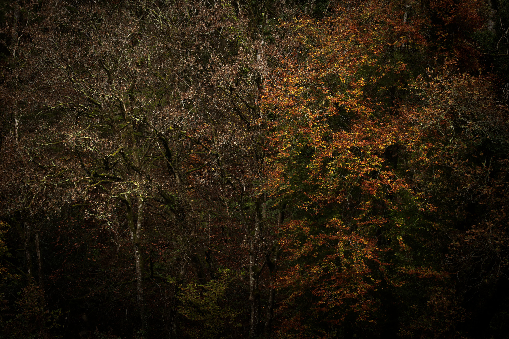
  <figcaption>
    Along the River Avon. (CC-BY-SA 4.0)
     
  </figcaption>
</figure>

### Strong Clinging Among Others 

The need for strong clinging becomes especially clear once we consider that we live among others.

Buddhism could tell us: everyone should just do less push-and-pull, and then the world would be better overall. While I do believe this, I also think just this is not enough. It lacks realism and differentiation. Imagine a predominantly, or even fully, Buddhist world: there would still be much push-and-pull, because people, groups, cultures, nations differ, and navigating the heterogeneity in how people want to live still requires a lot of tough clinging – to certain views of what we want amidst others who want different things, and to certain views of how to navigate differences and come to a consensus.

Moreover, if a fraction of people reaches a critical threshold of being ill-willed – and those relative differences in ill/good will are bound to occur, even in an exclusively Buddhist world – there will be a growing asymmetry in clinging: those with ill will might have more clinging relative to others, and they are often the ones who end up in positions of power. (This problem is likely more pronounced in a predominantly non-Buddhist world.)

There have been Buddhist rulers, and heads of state who practised deeply. But winning power in modern, competitive politics seems to select for strong clinging; it is not coincidental that we rarely see deeply practising Buddhists succeed there. To have a big impact in the world, one might argue, it might be necessary for someone with good will and skilful ideas to develop a lot of clinging and get to a position of influence.

An interesting edge case is [Thích Quảng Đức’s self-immolation](https://www.cfr.org/articles/the-self-immolation-of-thich-quang-duc) in 1963: the Vietnamese monk burned himself to death at a Saigon intersection, in protest against the Diệm regime’s persecution of Buddhists. He sat in meditation, motionless as he burned. He may not have been (much) attached to life anymore, but he clung to the idea of the power of peaceful protest to the extent that he sacrificed his life for it. Even here, at the far end of commitment, a view is solidified and held.

I’ve argued that wise action may require not only some, but strong clinging. The next question poses itself: clinging to what? Which view, which desire, which concrete trade-offs? Buddhism does not leave us empty-handed here: it offers ethical guidance – values such as compassion and generosity, and rules such as the precepts. But that guidance took shape in a far simpler world than ours, and today’s trade-offs – global, technological, entangled – rarely fall neatly under it. Where values and rules pull in different directions, its answer comes down to choosing a “skilful response, given particular conditions”, and what counts as skilful is left to be worked out. The second part of this post is about why Buddhism leaves this open, and where the content must come from instead. The third part then puts the two together.

<figure class="landscape">
  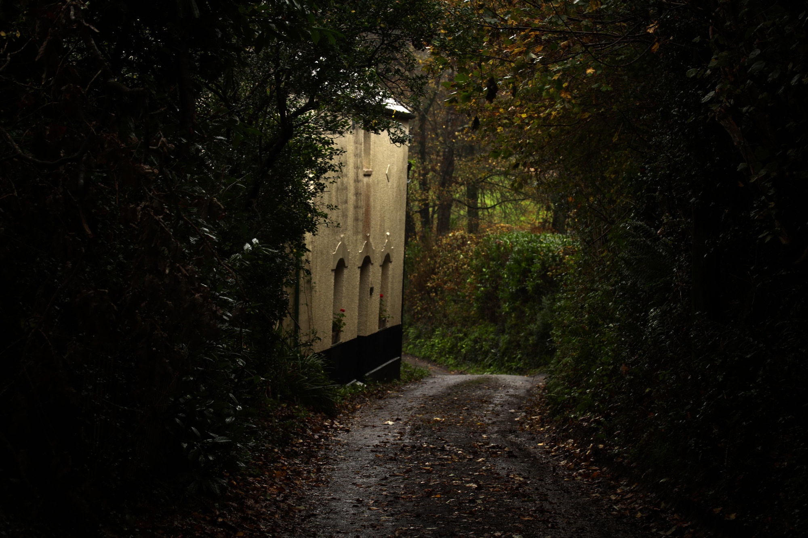
  <figcaption>
    Along the River Avon. (CC-BY-SA 4.0)
     
  </figcaption>
</figure>

## II. What to Cling to Must Come from Elsewhere 

### What Buddhism Leaves Open 

Buddhist teachings/meditation techniques provide a philosophy and tool to help us find out what a wiser way of living on this earth might mean to us. As said previously, they allow us to take a break from survival and train us in seeing the dependent origination of views and their ultimate emptiness, loosening unwise clinging to them, and helping us to see ourselves and the world around us in more complex, nuanced and more encompassing ways. This prepares us to choose a wiser view, appropriate for the conditions, inner and outer, at any given time. However, once we're back in the realm of acting and surviving, it says much less. Beyond broad orientation and a set of rules – which I'll come to – it remains largely open as to what a “useful”, “skillful”, “wiser” etc. action is. Where its rules run out, all it can say is: it will depend on the particular conditions at that time and place.

I don’t think this openness is a defect, rather, it follows from the question Buddhism set out to answer. Its founding question was: how does suffering arise, and how can it cease? And its distinctive answer locates suffering not in the circumstances as such, but in the mind’s *relation* to circumstances: in craving, aversion, clinging. That is why two people in identical situations can suffer very differently, and why the entire method targets the relation via practice, rather than world-improvement.

Now consider what acting is: choosing between possible states of the world. Any guide for action must be able to rank such states – to say that the world in which I took the job in the other city is preferable to the one in which I didn’t. But a theory whose target variable lives in the mind–world relation cannot do that ranking: the same world-state scores high or low depending on how the minds in it relate to it, and the recommended intervention is always on the relation side. Ask the Buddhist analysis about the job decision, and it will have genuinely useful things to say about my craving around the decision – the grasping at status, the aversion to uncertainty – but it returns no verdict on the decision itself. (This is not total: gross pain matters, and conditions affect one’s capacity to practise, so Buddhism can weakly rank world-states at the extremes at least. But the core target remains relational.) Buddhism answers the question it chose. What to do was never that question.[^8]

When we seriously think about acting and bringing positive change into our personal lives as well as on a societal level, we need to integrate many things that do not come from Buddhism: psychology and psychotherapy, rationality and the sciences, economics and politics, ethics, just to name a few areas, and not least accumulated lived experience.

<figure class="landscape">
  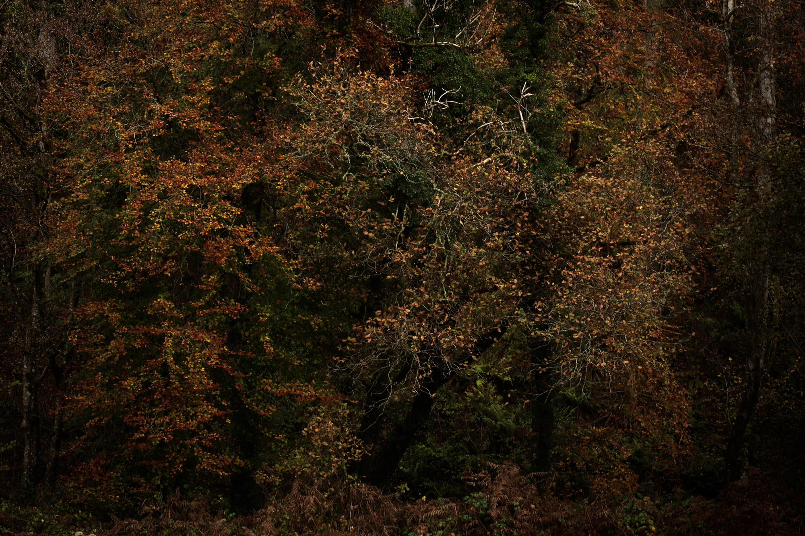
  <figcaption>
    Along the River Avon. (CC-BY-SA 4.0)
     
  </figcaption>
</figure>

This is not to say Buddhism offers no orientation at all. It gives us broad moral values like non-harm, loving kindness and compassion, and an ethics of conduct (sīla) to live them by. These can be orienting beacons, but they are hugely under-defined and do not specify what to do *concretely* – what “avoiding violence and not causing suffering to any living thing” means in light of real-world constraints where humans always have to make trade-offs. For instance, two people equally guided by compassion can reach opposite conclusions about whether one of them should leave a struggling relationship: staying read as compassion for the partner, leaving read as honesty that prevents deeper harm. On the societal level, you can take the same set of values, and both authoritarian and democratic groups will claim to follow them. Values as such often don’t adjudicate; the adjudication has to come from somewhere else.[^9]

Buddhism isn’t without concrete rules either. There are the precepts against killing, stealing, sexual misconduct, false speech and intoxicants; a list of livelihoods to avoid, including trade in weapons, living beings, meat, intoxicants and poisons; householder ethics such as the Sigālovāda Sutta’s account of what parents, spouses, teachers and friends owe one another; monastic and bodhisattva vows; even advice to rulers on relieving poverty to prevent crime. Rules are more specific than values, but they meet the same limit: they say what to do or avoid, not how to weigh one consideration against another when they pull apart – in a single relationship as much as in a society. They were also made for a very different world. A rule against trading in weapons, formulated when weapons were swords and spears, doesn’t tell an engineer whether to take a job at a firm whose sensors end up in both ambulances and military drones. That weighing has to be worked out with other sources. The rule against trading in weapons doesn’t tell an engineer whether to take a job at a firm whose sensors end up in both ambulances and military drones.

The same holds for the principle most often offered as the arbiter: reduction of suffering (*dukkha*). Take the obvious counterexample: an addict who prioritises short-term release over longer-term well-being. The standard rescue is that Buddhism means suffering reduction “over the long run”, in a “truly” fulfilling sense, but the rescue concedes the point. The qualifiers now do all the guiding work, and Buddhism does not supply them: what “fulfilling” and “long-lasting” mean has to be worked out with insights from psychology, ethics, and lived experience. Counterexamples like the addict don't refute the principle; they force its hidden qualifiers into the open.

Suffering reduction is an outcome-based arbiter - if outcomes can’t deliver here, perhaps intentions can: in Buddhism, one might say, what matters is not what an action brings about but the intention behind it. But this doesn’t fill the gap either; Buddhism equally leaves open which *concrete* intentions to form. Take the struggling relationship again, and suppose what's straining it is a partner's drinking. “May I and my partner be free from suffering” doesn't tell me whether that means insisting they stop, arranging an intervention, or leaving. And in many contexts, outcomes matter too – sometimes what a partner may need is for the drinking to actually stop.

Notice what kind of knowledge would settle the drinking case: how addiction works, what an intervention can and cannot do, when staying enables and when leaving abandons. None of that is something Buddhism as such can directly help with; it's psychological. And once the question is not one partner but many people – where help does the most good at a collective scale – a different kind of knowledge takes over again.

The tradition even has a name for this division of labour. Mahayana Buddhism, which puts the bodhisattva’s activity in the world at its centre, supplies the aim – compassion – and hands the method over to “skilful means” (*upāya*): whatever actually helps in the situation at hand. It even tells the bodhisattva to study the worldly sciences of the time – medicine, logic, language, the arts and crafts – in order to help. Practice can supply the impulse for this: deepening contact with suffering tends to bring a wish to relieve it, and that wish turns to investigating causes and conditions – with knowledge that largely lies outside Buddhism.

So the arbiters considered above – values, rules, the reduction of suffering, intention – were never meant to settle what to do on their own. Where they are treated as if they could, that is less the tradition’s claim than a hope common in contemporary practice circles: that Buddhist values, or deep enough practice, will show the way. It is that hope this section argues against. Today, the worldly sciences that bear on such questions include psychology for the partner who drinks and, at a collective scale, the kind of reasoning that asks where help does the most good. Those are the two sources I take up next.

<figure class="landscape">
  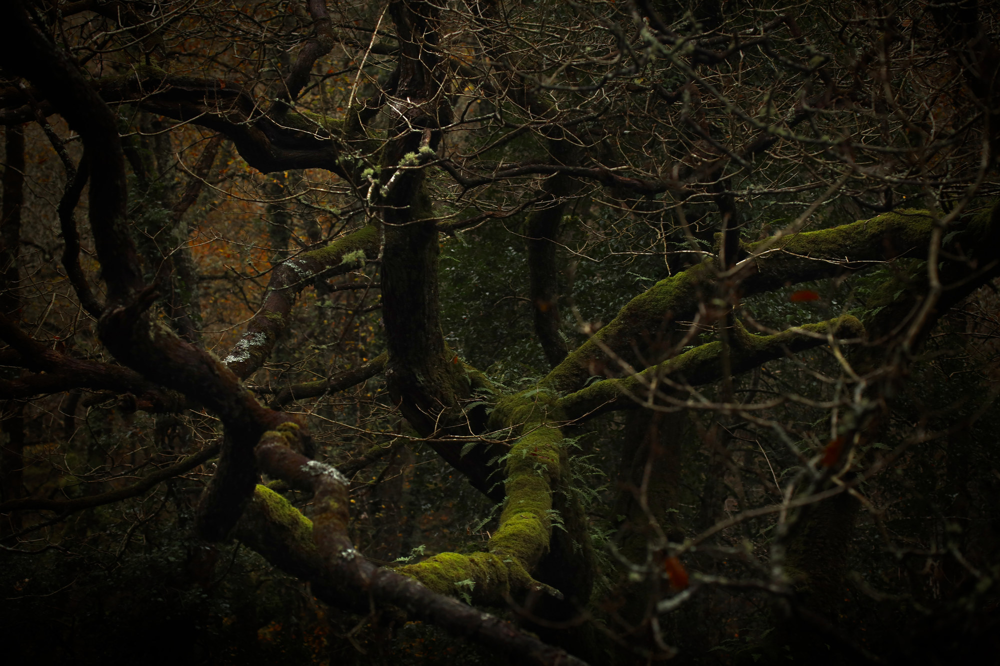
  <figcaption>
    Dartmoor National Park. (CC-BY-SA 4.0)
     
  </figcaption>
</figure>

### Individual Wellbeing – Insights From Psychotherapy 

I’ve argued that Buddhist practice alone doesn’t provide guidance on how to live concretely – practical wisdom about relationships, work, economy, political and worldly engagement. On an individual level, we need “psychological sophistication” alongside spiritual practice, using insights from developmental psychology and investigating attachment patterns, trauma responses, relational dynamics, all of which require us to engage with our own emotional life. This is not something that Buddhist teachings directly address.

Bruce Tift’s [Already Free](https://www.brucetift.com/already-free-book/) targets the relationship between psychology and Buddhism as two fundamentally different approaches to human suffering: Buddhism, on the one hand, emphasises accepting what is and recognising the constructed nature of selfhood and of the world of appearances, and psychotherapy, on the other, focuses on improving psychological functioning and developing a *healthier*, *more integrated* sense of self. Tift argues these exist in creative tension – they cannot be reconciled, because Buddhism works to loosen – not amplify, centralise or solidify – the very sense of self that psychotherapy aims to strengthen and heal. To navigate our lives among others, we always need a sense of self, and an unhealthy sense of self or view on one’s condition has to be replaced by a more healthy one.

Tift acknowledges that Buddhist practice excellently handles radical acceptance of what is, undoing destructive patterns of clinging and resistance, this fundamentally being a process of deconstructing unhelpful views on self and other. But Buddhism, I’d argue (and I think Tift would agree), can’t guide us in how to *reconstruct* (our sense of self and views of us and the world more generally).

I’d add that psychotherapy is very similar to Buddhist practice when it comes to step one: acceptance of what is (in Buddhism, this comes with a particular philosophical underpinning). Psychotherapy then goes further into the “action” realm: a therapist might first help someone accept their anxiety and then develop specific strategies – which never goes without ideas about how human experiences and relationships “work” – to address it. This might also involve replacing less skillful views on one’s condition with more useful ones. In Buddhist practice, we sit with the what-is step and are left to decide what a wise response is from there; we need to draw on other sources of knowledge to determine what those actions should be.

Acceptance-practice can not only stop short of reconstruction, but can also be misused to avoid it. There is an established name for that pattern: [spiritual bypassing](https://tricycle.org/magazine/human-nature-buddha-nature/), John Welwood’s term for using spiritual ideas and practices to sidestep unresolved psychological wounds and developmental tasks. According to Daniel Thorson’s [“avoidant dharma”](https://intimatemirror.substack.com/p/the-avoidant-dharma), Western non-attachment teachings can function as an avoidant attachment strategy in spiritual robes – decades of practice can leave avoidant patterns intact or even strengthened, with “letting go” providing sophisticated justification for avoiding contact. Notice what kind of insight this is: it may take a psychological framework (attachment theory) even to diagnose what one’s Buddhist practice is doing to oneself. And the point generalises beyond Buddhism: literally any method, whether psychotherapeutic, Buddhist, or something else, can be used to bypass. No framework is bulletproof against its own misuse. What protects against misuse is, I believe, not the framework but the kind of practice described in Part III: constant iteration, real-time awareness of what’s going on inside and outside of oneself, sharing it with one’s surroundings, meeting oneself and others with care.

<figure class="landscape">
  
  <figcaption>
    Dartmoor National Park. (CC-BY-SA 4.0)
     
  </figcaption>
</figure>

### Collective Well-being – Insights From Rationality 

If deciding what to do includes benefiting others (and perhaps many others), a further kind of insight may become relevant, this time coming from rationality. Consider someone who loves animals so much that she leaves her career in law to work at a pet sanctuary. There’s a beauty to putting love into action this way – and yet neglected pets make up a tiny fraction of animal suffering, while roughly ten billion chickens live and die in factory farms every year in the US alone. With her legal skills, she could push for regulation affecting a vast number of those animals. (The example is from Euan McLean’s [Unblocking Metta](https://integralaltruism.substack.com/p/unblocking-metta), lightly adapted.) Similarly, working in healthcare might feel good in a very direct way, because the positive effects of one’s actions on others are tangible; but, all things being equal, there might be professions that would be much more impactful, but don’t feel that good. This is a standard argument in [Effective Altruism](https://www.effectivealtruism.org/), which has a particular (and necessarily partial) view on how to do good in the world: part of that view is that we have to distinguish between what *feels* impactful and what demonstrably *is*. More generally, this movement attempts to contribute positively to the world using evidence and rationality, based on largely utilitarian principles.[^10]

This isn't to criticise activism or any particular job, nor to entirely discount the value of feeling good about something, but to say that effectiveness from a rationality point of view should be a (strong) consideration, alongside others.

### Doesn’t Engaged Buddhism Address Collective Flourishing? 

Once the question extends to the benefit of all, an obvious rejoinder arises: hasn’t Buddhism already developed its answer through [Engaged Buddhism](https://en.wikipedia.org/wiki/Engaged_Buddhism)? There is Thích Nhất Hạnh’s tradition on [collective awakening](https://www.parallax.org/product/interbeing-4th-edition/), or Joanna Macy’s [Work That Reconnects](https://workthatreconnects.org/what-is-the-work-that-reconnects/), which turned Buddhist practice into a framework for sustained ecological activism. (Macy’s practice of “honoring our pain for the world” is also, notably, a dharmic cousin of Mason’s point above: grief and outrage treated as expressions of interconnection to be worked with, not equanimised away.)

However, look at how these frameworks are built: Macy’s is explicitly Buddhism plus general systems theory plus deep ecology; she was a systems scholar, and it evidently took those components to turn dharma into a theory of engaged action, components fitted to the ecological and nuclear crises of her era. The pattern generalises: the engaged Buddhisms I know of are Buddhism plus imports, and the imports required scale with the complexity of the problems addressed. Today’s problems demand economics, game theory, machine learning, political science, institutional design – an open-ended list. Engaged Buddhism doesn’t refute the claim that the content of action must come from elsewhere; as I see it, it instantiates it. Even voices within Engaged Buddhism concede this: David Loy, in [Ecodharma](https://www.davidloy.org/books/ecodharma/)*,* argues the tradition must take on social and institutional analysis it does not natively possess if it is to meet crises of today’s scale.

Importing is not the problem. Every Buddhism has been a hybrid: Tibetan Buddhism grew out of Indian tantra and the local Bön tradition, Chan out of an encounter with Daoism, and Western Buddhism is in the middle of finding its own mix. Ethical conduct (*sīla*) supplies the root and motivation of engaged practice; the forms that practice took in the twentieth century were shaped by modern contexts. The problem is importing without labelling – presenting a borrowed theory as if it came from the dharma, which makes it harder to evaluate on its own merits. A Buddhist account of action should say which parts are Buddhist and which come from elsewhere.

<figure class="portrait">
  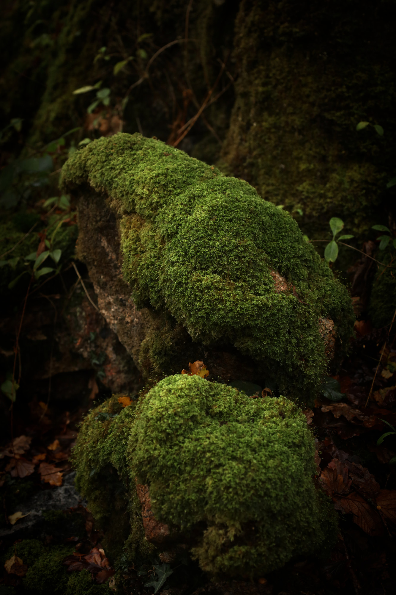
  <figcaption>
    Dartmoor National Park. (CC-BY-SA 4.0)
     
  </figcaption>
</figure>

### Why Drawing on Many Approaches and Perspectives Is Tough 

Drawing on many approaches is tough in part because of the age-old circumstance that we live in bubbles (although *how* we live in bubbles changes drastically within the mix of globalisation, the web, AI and social media dynamics we currently live in). These bubbles manifest across multiple nested systems: cognitively, we fall into confirmation bias and motivated reasoning; psychologically, we have our particular, biased ways of relating to the world (Buddhism, psychotherapy – “inner work” generally – do help here); relationally, we gravitate toward those who share our worldviews; professionally, a discipline trains a way of seeing that stops feeling like one – an economist sees incentives, a therapist attachment, a meditator clinging – and its jargon keeps the others out; geographically, we cluster in like-minded communities; and culturally, we inherit shared assumptions that become invisible background beliefs.[^11] Different communities may live and act separately and not talk to each other; group think settles in and leaves us with narrowed views.

All of this applies, in varying degrees, to Buddhists and Effective Altruists alike, including to sub-streams of both groups of people. Thorson describes [two bubbles inside Western Buddhism](https://intimatemirror.substack.com/p/the-upper-middle-path-and-tech-bro) itself: a “Consensus Buddhism” increasingly captured by progressive political frameworks, and a “Pragmatic Dharma” shaped by Silicon Valley’s optimisation mindset – each domesticating the teachings in its own image, each blind roughly where the other sees. Font makes the [corresponding observation about engagement](https://bernisdharma.substack.com/p/lets-start-the-year-thinking): much Western Buddhist engagement with social issues has become indistinguishable from mainstream progressive-left engagement, seasoned with Buddhist language. Indistinguishability is the tell: a community whose engagement mirrors one political camp's sees what that camp sees and misses what it misses, and its Buddhism is adding language rather than vantage. (There’s an irony in his conclusion, though: his demand that Buddhism stand for a distinctively Buddhist way of engaging asks the tradition to deliver exactly the action-content it leaves open. Perhaps Buddhism can contribute to the *how* of engagement – its quality and manner. The exact *what* still has to come from elsewhere.)

EA has its own bubbles: it can be too narrowly focused on quantifiable metrics and overly reliant on [decoupled](https://everythingstudies.com/2018/04/26/a-deep-dive-into-the-harris-klein-controversy/), analytical approaches that miss crucial systemic interdependencies, as well as neglect how to grow one’s commitment to altruism in the first place (which, in fact, is addressed by and can be cultivated through Buddhism). This ties in with EA often taking existing power structures – capitalism, competitive international dynamics, what Scott Alexander’s [Meditations on Moloch](https://slatestarcodex.com/2014/07/30/meditations-on-moloch/) calls “multipolar traps” – as given constraints rather than systems to be fundamentally challenged.[^12]

<figure class="landscape">
  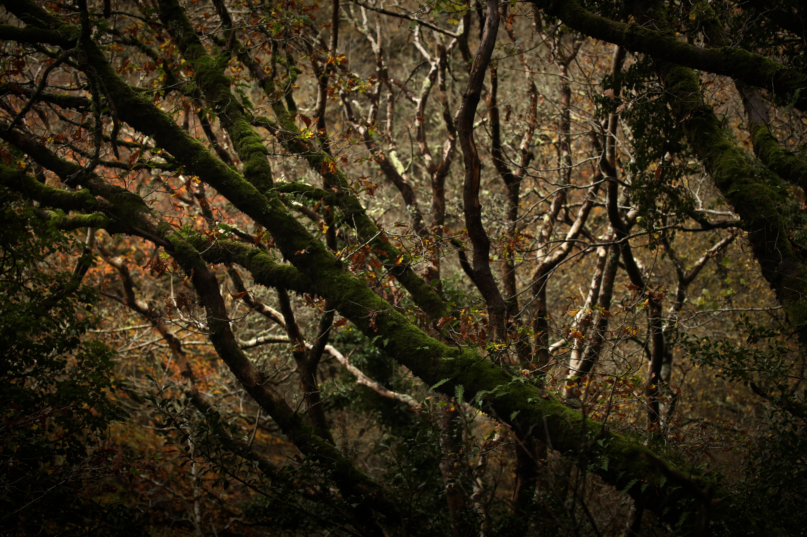
  <figcaption>
    Dartmoor National Park. (CC-BY-SA 4.0)
     
  </figcaption>
</figure>

McLean’s [Unblocking Metta](https://integralaltruism.substack.com/p/unblocking-metta) offers a helpful image here: love – *metta* – must travel from its source in a person all the way to beings in the world, like a river, and different traditions have learned to clear different blockages along its course, while none, as far as he can see, attends to the whole river. In his diagnosis – which I’ll extend a little – spiritual circles often perfect the “source” while the river never reaches the world: much cultivation, relatively little engagement, and, I would add, often little analytical rigour about where and how to act. In EA circles the strength lies downstream: rational analysis of where action might matter most, seeking out cause areas that are important, tractable, and neglected, with the potential to spare great amounts of suffering. Meanwhile, the felt connection to the beings one is working for (what McLean calls “heart”), can go missing, along with attention to one's own psychological patterns.[^13] And circles belonging to neither EA nor Buddhism may lack what both cultivate: EA's evidence-based way of asking where action does the most good, and the trained intimacy with one's own mind that Buddhism offers, among much else that any of these communities may be missing. The gaps may be complementary: each community holds roughly what another is missing which is why drawing on many approaches matters, and why the cost of bubbles is high.

Living together, as humans embedded in families, communities, political systems, economic structures, ecological relationships, engineered environments etc. requires many forms of knowledge. Pressed, most people would grant that no single approach – Buddhist, rationalist, therapeutic, or any other – can offer complete guidance for living. But bubbles don't work at the level of what we'd grant. They incline us to look for answers inside them, and answers found inside a bubble tend to look complete from there.

I’m not asking anyone to abandon the truth (and the good parts) of their own bubbles. Rather, I’m asking for a far-reaching openness to whatever presents itself as the otherness in this world to us – we need many sources and perspectives to triangulate what to do, and we need our certainties shaken to have access to a “greater”, “more complete” truth.

<figure class="landscape">
  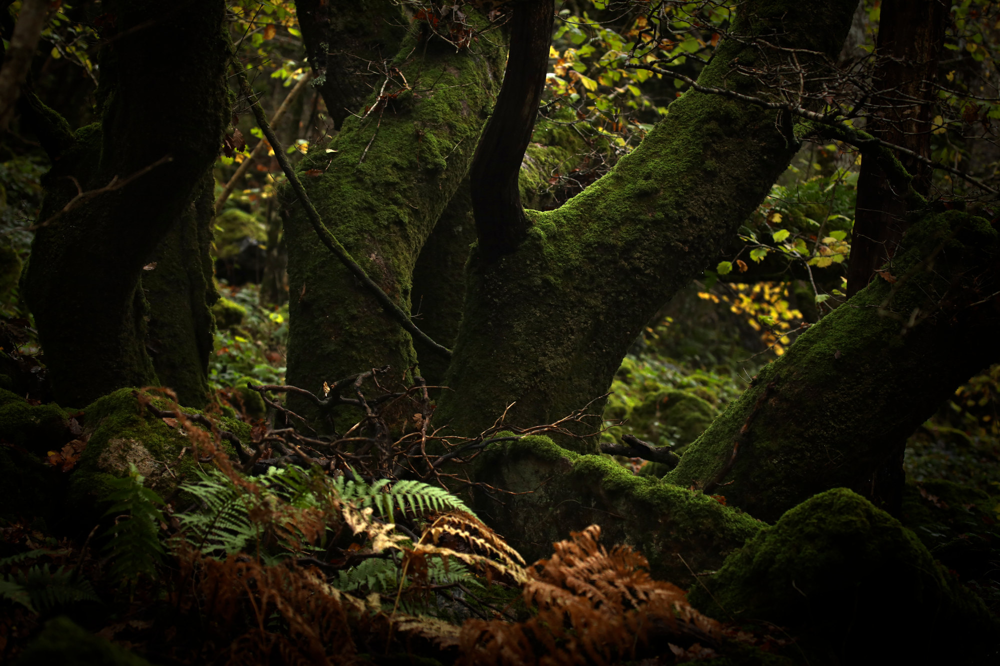
  <figcaption>
    Dartmoor National Park. (CC-BY-SA 4.0)
     
  </figcaption>
</figure>

### Integration Frameworks – and the Open Half of the Cycle 

Frameworks for integration exist, but what they integrate differs. On the strictly Buddhist side of things, two frameworks come to my mind that explicitly integrate desire and action: the [Four Fields framework](https://www.releasement.org/learn-more-about-the-four-fields-page), developed by the Buddhist scholar-practitioner Adam Lobel, treats four dimensions of experience – the material world, emotional/psychological experience, open awareness, and emptiness – as “equiprimordial”: equally fundamental and always present together. Its useful insistence is that we can’t retreat into pure meditation while ignoring the world’s problems, nor get so caught up in the urgency of action that we lose the spacious perspective which keeps us from burning out or becoming rigidly attached to particular strategies, combining “responsive action and the simple freedom of effortless non-action in […] a single gesture”. I welcome this endorsement of action – putting the solidification of views on stage right next to their deconstruction. Yet even a practitioner fully “integrated” across all four fields is not told by the framework which way of looking, and which concrete actions and trade-offs, are “more skillful” and thus preferable.

There’s also Rob Burbea’s soulmaking dharma, introduced earlier: where most Buddhist streams treat desire as something to be seen through and released, soulmaking explicitly integrates it into the path: desire as material for practice, to be tended and deepened rather than transcended. As I read it, though, what it integrates is the *quality* of desire – how it is held, its richness; like the Four Fields, it does not specify its content: which desires, directed at what, with which trade-offs.

More on the EA side of things with a Buddhist spin, one sub-movement comes to my mind that attempts to go beyond standard (rationalist/utilitarian/consequentialist) EA approaches and integrate many more sources, specifically wisdom traditions, complexity and systems thinking, embodiment and relational practice, and inner work alongside outer change, to figure out how to enable collective flourishing: [Integral Altruism](https://integralaltruism.substack.com/p/some-principles-for-integral-altruism). It is a very young and, so far, tiny movement trying to integrate EA’s rigour with epistemics and culture from wisdom traditions, and address gaps not only in EA, but other frameworks (like Buddhism), too.

What an integration may look like in practice is sketched out in McLean’s [Unblocking Metta](https://integralaltruism.substack.com/p/unblocking-metta), the piece that gave this post the river image. It mentions a number of gaps, and each turns out to be addressed from a different domain. Withdrawing from the world altogether, so that the love reaches no one, is addressed by the traditions of engagement discussed above. Not knowing where help is most needed or most effective is addressed by analytical, evidence-based approaches like EA. Working from intellectual conviction while the heart stays disengaged is addressed by practices that reconnect action to felt value. Acting from unmet personal needs disguised as altruism is addressed by psychotherapy and shadow work. And insisting on doing everything alone is addressed by relational practice and community. Most importantly, no single tradition can take care of the whole Metta river: different sources of knowledge help the water of love to flow.

Integral Altruism is at this point strongest on what I’d call the “loosening-one’s-view-and synthesising/assessing” phase: embracing uncertainty, holding many perspectives, deep listening. Whether it will develop distinctive guidance for the other phase – making difficult trade-offs in real-world contexts, at a collective level, in a way that differs from how effective altruists, Engaged Buddhists, or others already do – remains to be seen. And it may not: integration in the strong sense may simply not always be available. Perhaps no genuinely new “integral-altruistic” way of making trade-offs waits at the intersection, and what emerges is an additive combination of existing principles, or, in a given case, one principle alone – sometimes plain EA reasoning is the right tool, sometimes plain psychotherapy.

Thus, the ambition may shift: not finding the one framework that synthesises all others, but becoming fluent in several and judging, case by case, which to apply. What makes this hard to accept is the pull toward a single complete source that we've already met as the engine of bubbles – and a framework built to integrate many sources can become that single source as readily as Buddhism can. Buddhist communities relying on Buddhism for complete guidance are one instance; they are not special in it.

<figure class="landscape">
  
  <figcaption>
    Dartmoor National Park. (CC-BY-SA 4.0)
     
  </figcaption>
</figure>

## III. Deconstructing To Reconstruct: The Cycle Of Spacious Viewing And Focused Action 

Parts I and II have supplied two things: that action requires solidifying a view (Part I), and that the content of that view has to be gathered from many sources, most of them outside Buddhism (Part II). Both parts concern different stages in the *action cycle*: gathering and assessing (which Part II is about) require the opposite of solidifying – loosening one's grip on any view, holding several, letting them be weighed against each other; some perspectives will be frustrated and others prioritised; this is what action demands of us. Acting requires the loosening to recede and a view to be fixed and clung to, at times strongly (which Part I is about). And since any fixed view is a view of a momentary configuration of conditions, it must be loosened again when the conditions change, and the assessment redone. Loosen to assess; solidify to act; loosen again. These are shifts in emphasis, not separate stages: some looseness persists in action, and some fixity in assessment.[^14] This is the shape of wise action as I understand it, and it is neither entirely Buddhist nor rationalist nor therapeutic; each of those supplies some of it.

This makes clear that Buddhism's contribution to the two halves of this cycle is not symmetric: it helps us in the loosening excellently, and in the solidifying only in orientation. While Buddhism trains the loosening like nothing else (the deconstruction of views, the seeing of their dependent origination, the release of the push-and-pull), it has, by construction (for the reasons given in Part II) little to say about the solidifying half. It offers orientation – and I mean the word broadly: values such as compassion, non-harm and loving kindness, rules such as the precepts, and the care, even the intensity, that its practices can cultivate. All of this shapes the direction in which we act. But orientation does not define the contents. Which view exactly to reconstruct, which desire to invest in, which specific trade-off to make: none of this follows directly from the beacons, and Buddhism's own orientation is one among several that bear on such choices. The content ultimately has to come from an agglomeration and synthesis of many things. Buddhism can’t supply the strong clinging that, as Part I argued, wise action sometimes needs either. Even where it works with intensity, as Vajrayana does, it aims to free that intensity from clinging rather than to strengthen the clinging; clinging strong enough to carry a cause through opposition is something almost every tradition would count as unwholesome. That is what makes Buddhism a starting point rather than a full guide. It gives us the capacity to hold views lightly and revise them, and a direction to hold them in; it does not give us the exact views. Assessing options and taking action is a dance between loosening and solidifying, and Buddhism is a teacher primarily in one of the two steps.

Part II ended by recommending fluency in several approaches, and choosing, case by case, which to apply. That moves the problem rather than solving it: what does the choosing? If no framework tells us which framework fits, the judgment doing the choosing is where the content lives – what Aristotle called practical wisdom (*phronesis*). I don’t think a meta-framework can supply it. Aristotle himself held that practical wisdom is concerned with [particulars, which become familiar from experience](https://www.ellopos.net/elpenor/greek-texts/ancient-greece/aristotle/nicomachean-ethics.asp?pg=103). Training judgment therefore starts from the particular contexts one is actually embedded in, which is not where EA and Integral Altruism start (see footnote 12). Their question, “how do I improve the world?”, begins at the largest scale and works downwards: first a picture of the whole, then a ranking of its problems, and only then action. But in a world this entangled and interconnected, the ranking cannot really be done (with any certainty); no one knows which problem matters *most*, and the honest substitute is a good guess, an acceptance that many things matter, and trade-offs made in light of one’s values, skills and circumstances. Starting from a context reverses the order – a context presents real problems and returns real feedback: a running club that can’t attract members and a government trying to broker a peace are both contexts in this sense; a circle of people elaborating theories about a domain they are not in touch with is not. Interventions in a real context can be tested and built on.

Within any context, judgment begins with one’s own emotional experience. What working with that experience well requires is, I find, incredibly hard to pin down – it is a lifelong journey, and any model of it will be partial. With that caveat, the elements I can name are these: actually *feeling* what is there, in the body – which good meditative practice itself encourages, and which spiritual bypassing avoids while appearing to do it. Treating emotions as signals that carry information about unmet needs, violated boundaries and things that matter, and responding to what they point at rather than merely dissolving or dissociating from the feeling. Testing those responses against reality and iterating on what does and doesn’t shift. And doing much of this *in relationship*, since our patterns were formed with others and rarely change in solitude. This is already a form of acting in the world.

Meditation, psychotherapy, the empirical habit of testing and relational practice all contribute to our ability to make good judgments. Its test stays the same throughout: not how a choice looks in theory or feels on the cushion, but whether the patterns of one’s actual life, and of the contexts one acts in, actually *move*. Judgment is trained by running the cycle over and over again: loosen, commit, see what happens, loosen again.

<figure class="portrait">
  
  <figcaption>
    Dartmoor National Park. (CC-BY-SA 4.0)
     
  </figcaption>
</figure>

## Concluding Words 

This post has moved in three steps: what it takes to act at all; where the content of wise action has to come from; and how acting well, in practice, moves back and forth between loosening our views and solidifying them.

The first concerned the foundations of action. To act at all, a being that has to survive must select one view – of itself, its conditions, what it wants – over others and rely on it, with something now at stake. Seeing that view as empty changes how tightly it is held, not whether it is held – and *holding*, however light, is already some degree of clinging. Relative freedom from the push-and-pull is available at any moment; absolute freedom is not, short of no longer perceiving or acting at all. And wise action may need more than some clinging: at times strong clinging, of a kind most traditions would count as unwholesome – the felt intensity that turns a conclusion into an act, and the capacity to hold one’s view among others who hold theirs.

The second concerned where the content of wise action comes from. Buddhism orients – through its values and rules, and through the care and intensity its practices can cultivate – but it cannot settle which view to take on, which desire to invest in, which concrete trade-off to make. That follows from the question it set out to answer: it aimed at the mind’s relation to circumstances, not at which circumstances to bring about. The content must be supplied by many more sources – psychology and psychotherapy, rationality and the sciences, politics, lived experience – and gathering it is hard, because bubbles make partial answers look complete, integrative frameworks included.

The third brought the first two parts together into an action cycle: loosening our grip to assess, drawing on as many perspectives as we can reach; solidifying – at times strongly – around a synthesised view in order to act; loosening again when conditions change. These are shifts in emphasis rather than separate stages, and Buddhism’s contribution to them is not symmetric: it trains the loosening like nothing else and orients the solidifying, but ultimately does not supply its content. Nor does any other single framework. What decides, in the end, is judgment – practical wisdom – and judgment is not derived but trained, by running this same cycle again and again in the contexts we are actually embedded in: committing, seeing what shifts, loosening again.

That makes Buddhism a starting point, and an excellent one. The danger lies where Buddhist communities take it for more: as *complete* guidance for living, and/or as justification for non-action.¹⁵ It’s this differentiation, and clarity around the area of responsibility, that I am missing in discussions in the Buddhist community.

## Coda: No End-States 

I share a closing thought, held lightly: when it comes to the question of what to do, I sometimes encounter the hope that our lives and the world are converging towards a desired end-state – always improving in some way. There’s some truth to that, and it is also misleading. Individually, we won’t arrive at a place that reveals the ultimate meaning of life to us, no point at which we finally have it all figured out; collectively, we won’t arrive at an end-state where we have finally found the best way to live together either. The world goes in cycles – of connection and disconnection, creation and destruction, clarity and confusion, birth and death – an inescapability that reaches, if Sean Carroll’s [musings on immortality](https://www.preposterousuniverse.com/podcast/2023/12/18/holiday-message-2023-reflections-on-immortality/) are right, as far as the heat death of this universe and, on a speculative proposal of his and Jennifer Chen’s, the tabula-rasa birth of new universes out of it.

Perhaps the deepest practice is learning to embrace and love the world in this cyclic totality – in its beauty and its horror – while acting, at times fiercely, within it: a kind of cosmic self-compassion in which, just as we gain the capacity to love the rejected parts of ourselves, we learn to love the rejected parts of our world. This is not resignation, but acting with fierce tenderness while transcending the need for everything to be other than it is.

## Acknowledgements 

I want to thank Nathan Glyde, Marc Santolini, Moritz Boos, Euan McLean and Jacob Guenther for their generous and searching feedback on earlier drafts; the post is without doubt a better one for it. Euan and Moritz pushed me to trace solidification back to perception, Jacob to give Buddhism’s cultivating side its due, Marc to name the lineage I write from, and Nathan to test the argument against the tradition. Not everyone named here agrees with what I’ve argued, and any remaining errors are my own.

[^1]: One strand among several. In the Pali texts, emptiness mostly means that phenomena are empty of a self or of anything belonging to one. Madhyamaka goes further: nothing exists inherently – neither the content of experience, nor awareness itself. I follow the Madhyamaka reading throughout, mainly via Rob Burbea's [Seeing That Frees](https://hermesamara.org/seeing-that-frees).

[^2]: Dependent origination (*paṭicca samuppāda*): the teaching that all phenomena arise in dependence on conditions – nothing exists independently, from its own side. A view of a thing is therefore always a view of a momentary configuration of *conditions*, never of a free-standing *essence*. See the [Stanford Encyclopedia of Philosophy](https://plato.stanford.edu/entries/buddha/) for an overview, and Rob Burbea’s [Seeing That Frees](https://hermesamara.org/seeing-that-frees) for a practice-oriented treatment.

[^3]: Neuroscience studies the moment of commitment directly under the heading of [perceptual decision-making](https://www.annualreviews.org/content/journals/10.1146/annurev.neuro.29.051605.113038): the brain accumulates noisy evidence until it crosses a threshold and commits to one interpretation. How much evidence it needs before committing is itself adjustable – another sense in which solidification comes in degrees.

[^4]: This is a claim about a *sense* of self, rather than a self that “objectively exists out there”: there need not be a real agent behind the action, but whatever acts in order to survive has to model itself as *bounded*.

[^5]: The tradition itself grades awakening. In Tsongkhapa’s Gelug reading of Madhyamaka, an arahant – a being in whom craving is extinguished – has removed the obscurations rooted in afflictive emotions, but not the subtler obscurations to knowledge, which include the appearance of things as inherently existent. Only a buddha removes those, and only a buddha perceives conventional and ultimate truth at once; everyone else alternates between them, which is close to the cycle of loosening and solidifying in Part III. Buddhahood, so described, is the being free of both constraints whose possibility I doubt. Other schools, such as the Nyingma and Kagyu, describe awakening differently. For an accessible account of Tsongkhapa’s view, see Guy Newland’s [Introduction to Emptiness](https://bodhicitta.tsadra.org/index.php/Books/Introduction_to_Emptiness).

[^6]: Burbea argues that time, self and things are fabricated together in perception, and that seeing the emptiness of time reveals the emptiness of awareness. Yahel Avigur, in a [conversation with Amir Giles](https://www.youtube.com/watch?v=pqj0vxe57-w), makes the point more directly: consciousness, perception and time co-arise, and there is no unconditioned awareness. If so, there is no pure awareness standing outside perception from which one could act without any solidification.

[^7]: It is interesting to think about how both ends of that spectrum relate to awareness and solidifying vs. loosening: actions (and therefore solidification of views) both big and small can play out with or without our noticing. A percept is fixed below awareness, and so can be a relational pattern formed early in life that quietly shapes everything after it, while a coffee or a change of job may be weighed in full view. Loosening, too, can happen unnoticed: an ambiguous picture flips by itself, the brain revises predictions that keep failing, a loss or a love can shake a whole life script without any reflection. But unnoticed loosening seems mostly forced – it happens when a view breaks (strongly) against reality. Loosening can also be *chosen*, as the holding of a view more lightly, and with enough training it can become like second nature. That chosen, cultivated loosening is what Buddhist practice trains.

[^8]: That choice may itself have been historical. Two and a half thousand years ago, people had little understanding of, or control over, disease, food supply or child mortality; changing one’s relation to suffering may have been the best cure available, and the tradition casts the Buddha as a physician offering one. The wish to reshape the world at large may itself be modern, a child of the Enlightenment and the scientific revolution.

[^9]: One might picture the division of labour as a hierarchical one: Buddhism supplies the orientation, e.g., compassion and non-harm, and other sources of knowledge fill in the details. I don’t think that picture is right, because influence runs both ways: what we learn about the world, and the experiences we have in it, including trade-offs to be made and constraints to be navigated, change what we take compassion and non-harm to mean. [Capucine Griot](https://www.ecoleader.online/artikel/from-insight-to-impact-the-role-of-compassion-in-living-a-good-life) describes this from the inside: encountering effective altruism (EA, a movement that uses evidence and careful reasoning to do good more effectively; I return to it properly in the main text) didn’t add strategy on top of her compassion – it changed what her compassion was, by forcing her to confront what caring about impact really means.

[^10]: On an individual level, doing so via one’s professional life is one of the standard EA recommendations, supported by a whole EA-affiliated organisation, 80,000 Hours.

[^11]: Political polarisation is one extreme consequence of living in bubbles. In a [conversation between Sean Carroll and Ezra Klein](https://preposterousuniverse.com/podcast/2020/01/27/81-ezra-klein-on-polarization-politics-and-identity/) on polarisation, politics, and identity, Klein argues that polarisation intensifies when previously independent beliefs begin clustering together, creating stark partisan divisions where positions on seemingly unrelated issues become predictably correlated. Commonly suggested mitigations include actively seeking diverse information sources, engaging with people from different backgrounds, practising intellectual humility, and designing systems that reward bridge-building rather than tribal solidarity. The challenge is that bubbles often feel protective and validating, making them difficult to recognise from within.

[^12]: For many problems, expected utility maximisation becomes nearly impossible, as we lack clarity about our ultimate goals and the pathways to achieve them, leaving us navigating profound uncertainty about both ends and means. The movement also tends to prioritise measurable outcomes over the intrinsic value of processes themselves; the quality of how we engage matters, not just what we achieve. Behind both, I suspect, is the starting question EA shares with Integral Altruism (a sub-movement which I’ll say more about later): “how do I improve the world?” It invites top-down reasoning – theorise about the world at large, derive a priority list, then act – although which problem is “most important” is, in a world this interconnected, mostly unknowable. The alternative is to start where one already is – in the situations one is part of, which answer back when one acts – and that, I argue in Part III, is also where practical judgment is trained. None of this makes these communities less valuable: they bring together people who would not otherwise be in one room, and that can have significant ripple effects.

[^13]: One might object that motivation is not fungible: the lawyer’s love for animals grew from contact with particular animals, and it may not carry over to years of legal work for chickens she will never meet. If the argument can’t move her, working with animals directly may be the most rational option she has; and where care is too narrow, it can be cultivated – which is exactly what the “source” traditions train.

[^14]: Bryan Kam and Isabela Granic describe a related oscillation in their [Neither/Nor](https://www.nature.com/articles/s41599-026-06669-3) framework, though between conceptual and experiential knowing rather than between loosening and solidifying views. Neither mode suffices on its own: leaning too hard on concepts breeds dogmatism, leaning too hard on experience and doubt can stall action, and the skill lies in moving deliberately between the two as the situation demands – not like a fixed pendulum.

## References 

Translations of the Pāli suttas are also freely available at [https://suttacentral.net/](https://suttacentral.net/).

### Buddhist texts 

AN 5.177, *Vaṇijjā Sutta* (Trades). In B. Bodhi (Trans.), *The Numerical Discourses of the Buddha*. Wisdom Publications, 2012.

DN 5, *Kūṭadanta Sutta*, and DN 26, *Cakkavatti-sīhanāda Sutta*. In M. Walshe (Trans.), *The Long Discourses of the Buddha*. Wisdom Publications, 1995.

DN 31, *Sigālovāda Sutta*. In M. Walshe (Trans.), *The Long Discourses of the Buddha*. Wisdom Publications, 1995.

SN 22.48, *Khandha Sutta*; SN 35.85, *Suñña Sutta*; SN 36.6, *Sallatha Sutta*. In B. Bodhi (Trans.), *The Connected Discourses of the Buddha*. Wisdom Publications, 2000.

Bodhi, B. (Ed.). (1993). *A Comprehensive Manual of Abhidhamma*. Buddhist Publication Society.

*The Diamond Sutra*. (2001). Red Pine (Trans.). Counterpoint.

*The Platform Sutra of the Sixth Patriarch*. (1967). P. B. Yampolsky (Trans.). Columbia University Press.

*Mahāyānasūtrālaṃkāra* (attributed to Maitreya), XII.60 (XI.60 in some editions). In Dharmachakra Translation Committee (Trans.), *Ornament of the Great Vehicle Sūtras*. Snow Lion, 2014.

*Ratnagotravibhāga* (attributed to Maitreya), ch. 4. In R. Fuchs (Trans.), *Buddha Nature: The Mahayana Uttaratantra Shastra*. Snow Lion, 2000.

Takuan Sōhō. (2012). *The Unfettered Mind: Writings from a Zen Master to a Master Swordsman* (W. S. Wilson, Trans.). Shambhala. (Original translation published 1986.)

### Other works 

80,000 Hours. [https://80000hours.org/](https://80000hours.org/)

Alexander, S. (2014, 30 July). Meditations on Moloch. *Slate Star Codex*. [https://slatestarcodex.com/2014/07/30/meditations-on-moloch/](https://slatestarcodex.com/2014/07/30/meditations-on-moloch/)

Aristotle. *Nicomachean Ethics*, VI.8, 1142a12–16. Elpenor bilingual edition. [https://www.ellopos.net/elpenor/greek-texts/ancient-greece/aristotle/nicomachean-ethics.asp?pg=103](https://www.ellopos.net/elpenor/greek-texts/ancient-greece/aristotle/nicomachean-ethics.asp?pg=103) [Add the translator named on that page.]

Avigur, Y., & Giles, A. [Add date, title and channel.] [Video]. YouTube. [https://www.youtube.com/watch?v=pqj0vxe57-w](https://www.youtube.com/watch?v=pqj0vxe57-w)

Brown, H., Adams, R. A., Parees, I., Edwards, M., & Friston, K. (2013). Active inference, sensory attenuation and illusions. *Cognitive Processing*, *14*(4), 411–427. [https://doi.org/10.1007/s10339-013-0571-3](https://doi.org/10.1007/s10339-013-0571-3)

Burbea, R. (2014). *Seeing That Frees: Meditations on Emptiness and Dependent Arising*. Hermes Amāra Publications. [https://hermesamara.org/seeing-that-frees](https://hermesamara.org/seeing-that-frees)

Burbea, R. *Soulmaking Dharma*. Hermes Amāra. [https://hermesamara.org/teachings/soulmaking-dharma](https://hermesamara.org/teachings/soulmaking-dharma)

Carroll, S. (Host). (2020, 27 January). 81 \| Ezra Klein on polarization, politics, and identity [Podcast episode]. *Mindscape*. [https://preposterousuniverse.com/podcast/2020/01/27/81-ezra-klein-on-polarization-politics-and-identity/](https://preposterousuniverse.com/podcast/2020/01/27/81-ezra-klein-on-polarization-politics-and-identity/)

Carroll, S. (Host). (2023, 18 December). Holiday message 2023: Reflections on immortality [Podcast episode]. *Mindscape*. [https://www.preposterousuniverse.com/podcast/2023/12/18/holiday-message-2023-reflections-on-immortality/](https://www.preposterousuniverse.com/podcast/2023/12/18/holiday-message-2023-reflections-on-immortality/)

Carroll, S. (Host). (2025, 17 February). 305 \| Lilliana Mason on polarization and political psychology [Podcast episode]. *Mindscape*. [https://www.preposterousuniverse.com/podcast/2025/02/17/305-lilliana-mason-on-polarization-and-political-psychology/](https://www.preposterousuniverse.com/podcast/2025/02/17/305-lilliana-mason-on-polarization-and-political-psychology/)

Carroll, S. M., & Chen, J. (2004). Spontaneous inflation and the origin of the arrow of time. arXiv:hep-th/0410270. [https://arxiv.org/abs/hep-th/0410270](https://arxiv.org/abs/hep-th/0410270)

Effective Altruism. [https://www.effectivealtruism.org/](https://www.effectivealtruism.org/)

*Encyclopaedia Britannica*. Buddhism: Vajrayana (Tantric or Esoteric Buddhism). [https://www.britannica.com/topic/Buddhism/Vajrayana-Tantric-or-Esoteric-Buddhism](https://www.britannica.com/topic/Buddhism/Vajrayana-Tantric-or-Esoteric-Buddhism)

Engaged Buddhism. In *Wikipedia*. [https://en.wikipedia.org/wiki/Engaged\_Buddhism](https://en.wikipedia.org/wiki/Engaged_Buddhism)

Font, B. (2025, 2 January). Should Buddhism take sides? *Berni’s Dharma*. [https://bernisdharma.substack.com/p/lets-start-the-year-thinking](https://bernisdharma.substack.com/p/lets-start-the-year-thinking)

Fossella, T. (2011, Spring). Human nature, Buddha nature: An interview with John Welwood. *Tricycle*. [https://tricycle.org/magazine/human-nature-buddha-nature/](https://tricycle.org/magazine/human-nature-buddha-nature/)

Gold, J. I., & Shadlen, M. N. (2007). The neural basis of decision making. *Annual Review of Neuroscience*, *30*, 535–574. [https://doi.org/10.1146/annurev.neuro.29.051605.113038](https://doi.org/10.1146/annurev.neuro.29.051605.113038)

Griot, C. [Add date.] From insight to impact: The role of compassion in living a good life. *Ecoleader*. [https://www.ecoleader.online/artikel/from-insight-to-impact-the-role-of-compassion-in-living-a-good-life](https://www.ecoleader.online/artikel/from-insight-to-impact-the-role-of-compassion-in-living-a-good-life)

Jayasaro, Ajahn. [Add date.] Just do it. *Lion’s Roar* (Buddhadharma). [https://www.lionsroar.com/just-do-it/](https://www.lionsroar.com/just-do-it/)

Kam, B., & Granic, I. [Check full author list.] (2026). Neither/nor: A pragmatic philosophy for oscillating between conceptual and experiential knowledge. *Humanities and Social Sciences Communications*. [https://doi.org/10.1057/s41599-026-06669-3](https://doi.org/10.1057/s41599-026-06669-3)

Laukkonen, R. E., & Slagter, H. A. (2021). From many to (n)one: Meditation and the plasticity of the predictive mind. *Neuroscience and Biobehavioral Reviews*, *128*, 199–217. [https://doi.org/10.1016/j.neubiorev.2021.06.021](https://doi.org/10.1016/j.neubiorev.2021.06.021)

Lindsay, J. M. (2012, 11 June). TWE remembers: Thich Quang Duc’s self-immolation. *The Water’s Edge*, Council on Foreign Relations. [https://www.cfr.org/articles/the-self-immolation-of-thich-quang-duc](https://www.cfr.org/articles/the-self-immolation-of-thich-quang-duc) [Check that your link is this article.]

Lobel, A. The Four Fields. *Releasement*. [https://www.releasement.org/learn-more-about-the-four-fields-page](https://www.releasement.org/learn-more-about-the-four-fields-page)

Loy, D. R. (2018). *Ecodharma: Buddhist Teachings for the Ecological Crisis*. Wisdom Publications. [https://www.davidloy.org/books/ecodharma/](https://www.davidloy.org/books/ecodharma/)

Macy, J., & Brown, M. Y. (2014). *Coming Back to Life: The Updated Guide to the Work That Reconnects*. New Society Publishers.

McLean, E. [Add date.] Unblocking metta. *Integral Altruism*. [https://integralaltruism.substack.com/p/unblocking-metta](https://integralaltruism.substack.com/p/unblocking-metta)

McLean, E. (2026, 24 February). Some principles for integral altruism. *Integral Altruism*. [https://integralaltruism.substack.com/p/some-principles-for-integral-altruism](https://integralaltruism.substack.com/p/some-principles-for-integral-altruism)

Nerst, J. (2018, 26 April). A deep dive into the Harris–Klein controversy. *Everything Studies*. [https://everythingstudies.com/2018/04/26/a-deep-dive-into-the-harris-klein-controversy/](https://everythingstudies.com/2018/04/26/a-deep-dive-into-the-harris-klein-controversy/)

Newland, G. (2008). *Introduction to Emptiness: As Taught in Tsong-kha-pa’s Great Treatise on the Stages of the Path*. Snow Lion. [https://bodhicitta.tsadra.org/index.php/Books/Introduction\_to\_Emptiness](https://bodhicitta.tsadra.org/index.php/Books/Introduction_to_Emptiness)

Parr, T., Pezzulo, G., & Friston, K. J. (2022). *Active Inference: The Free Energy Principle in Mind, Brain, and Behavior*. MIT Press. [https://directory.doabooks.org/handle/20.500.12854/84566](https://directory.doabooks.org/handle/20.500.12854/84566)

Seth, A. (2021). *Being You: A New Science of Consciousness*. Faber & Faber. [https://www.anilseth.com/being-you/](https://www.anilseth.com/being-you/)

Siderits, M. Buddha. In *The Stanford Encyclopedia of Philosophy*. [https://plato.stanford.edu/entries/buddha/](https://plato.stanford.edu/entries/buddha/) [Add the edition shown at the foot of the entry.]

Thich Nhat Hanh. (2020). *Interbeing: The 14 Mindfulness Trainings of Engaged Buddhism* (4th ed.). Parallax Press. [https://www.parallax.org/product/interbeing-4th-edition/](https://www.parallax.org/product/interbeing-4th-edition/)

Thorson, D. [Add date.] The avoidant dharma. *The Intimate Mirror*. [https://intimatemirror.substack.com/p/the-avoidant-dharma](https://intimatemirror.substack.com/p/the-avoidant-dharma)

Thorson, D. (2025, 11 March). The upper middle path and tech bro Buddhism. *The Intimate Mirror*. [https://intimatemirror.substack.com/p/the-upper-middle-path-and-tech-bro](https://intimatemirror.substack.com/p/the-upper-middle-path-and-tech-bro)

Tift, B. (2015). *Already Free: Buddhism Meets Psychotherapy on the Path of Liberation*. Sounds True. [https://www.brucetift.com/already-free-book/](https://www.brucetift.com/already-free-book/)

Work That Reconnects Network. What is the Work That Reconnects? [https://workthatreconnects.org/what-is-the-work-that-reconnects/](https://workthatreconnects.org/what-is-the-work-that-reconnects/)
