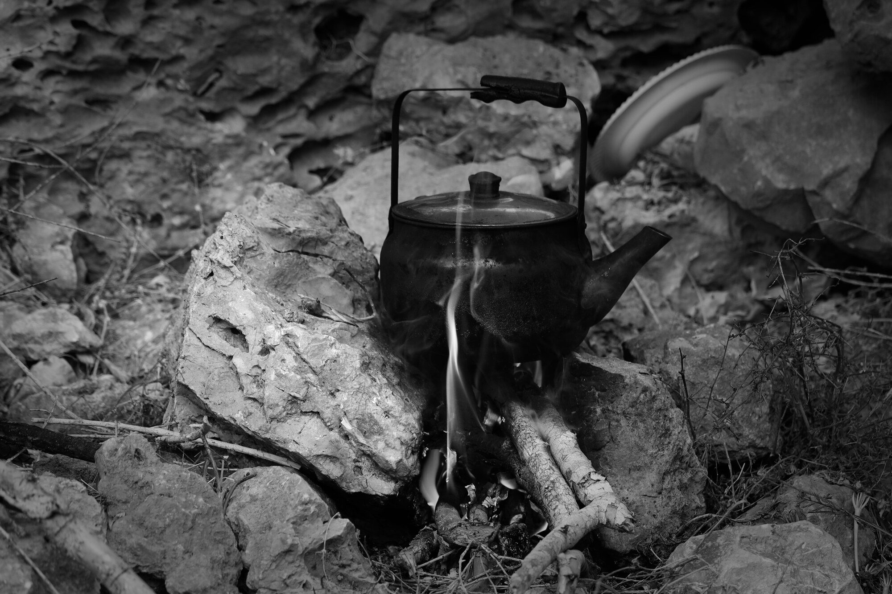
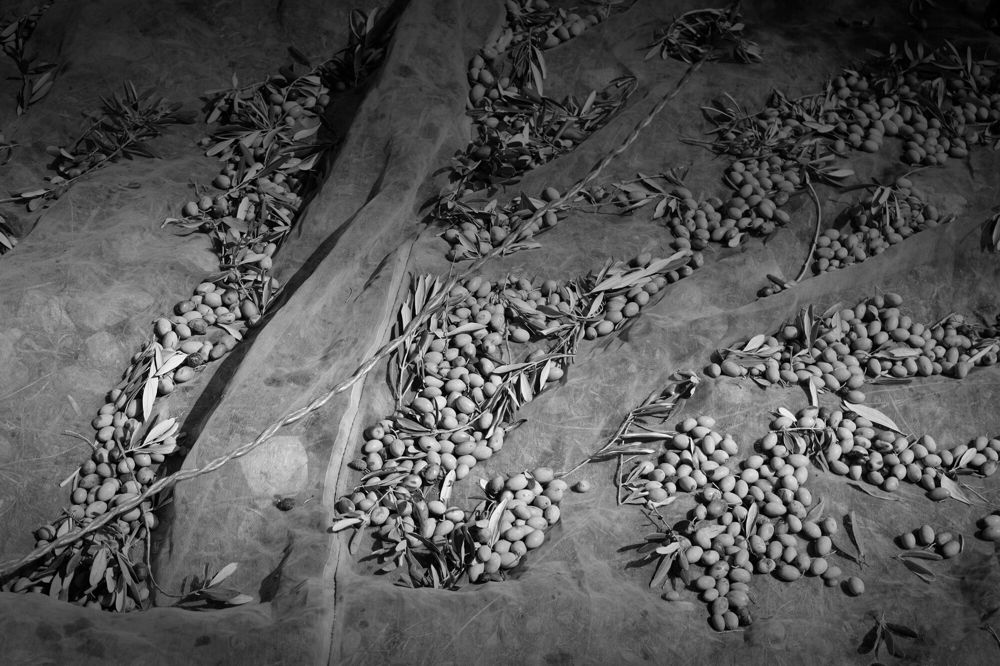
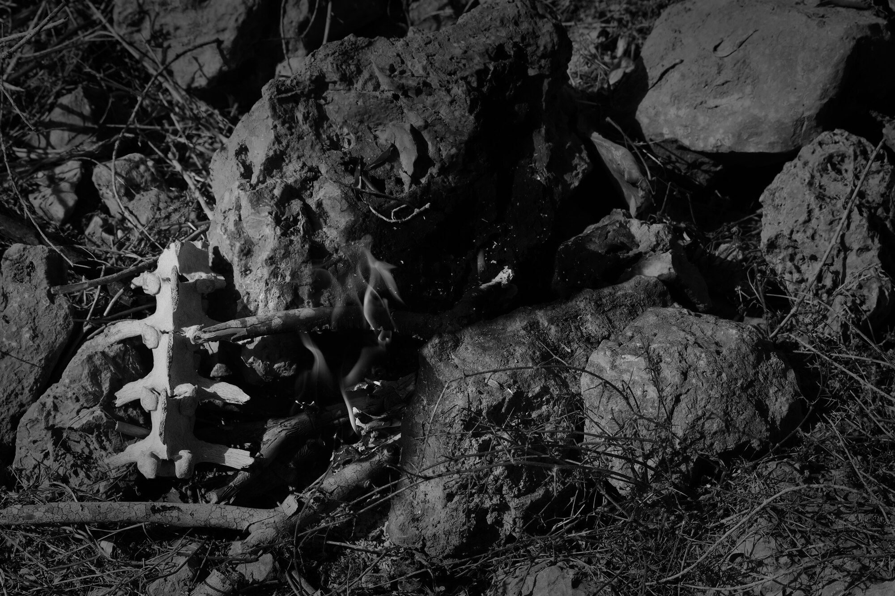
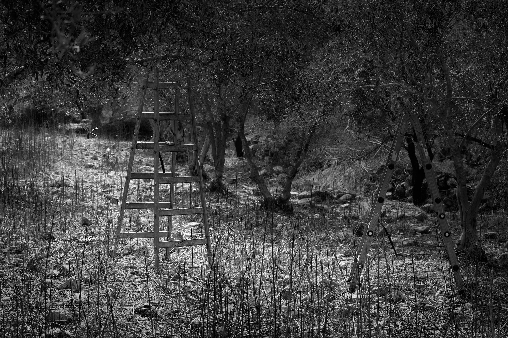
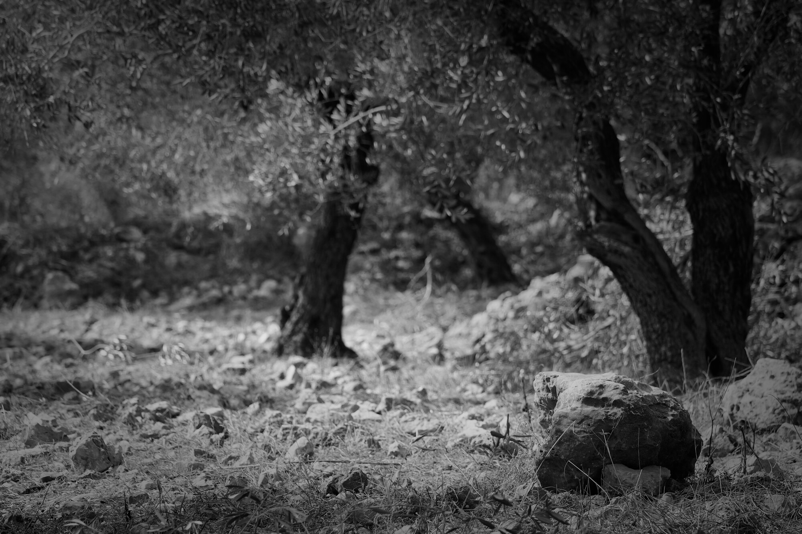
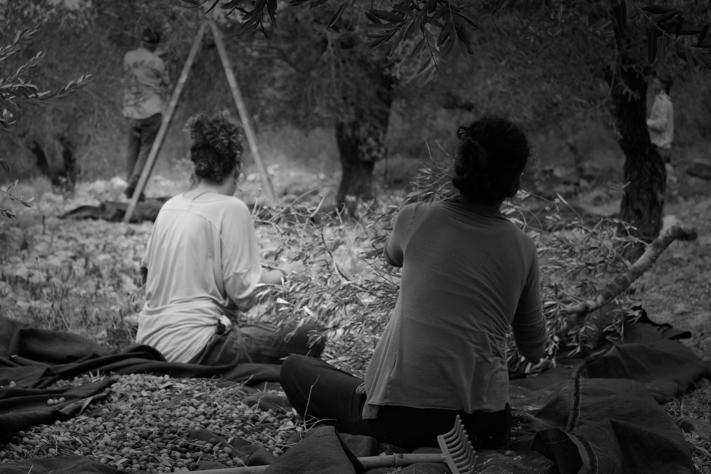
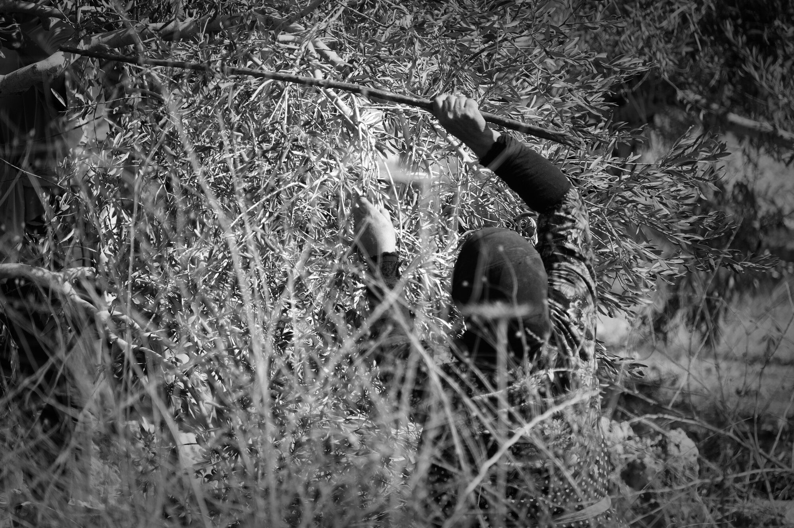
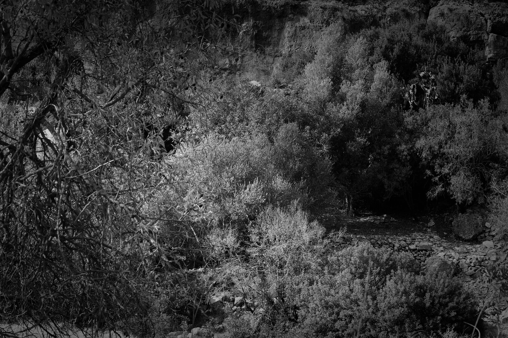

---
output:
  html_document:
    keep_md: true

title: "What Facts Can’t Do"
date: 2026-11-25
permalink: /posts/2026/11/what-facts-cant-do/
tags:
  - Palestine
  - Israel
  - peacebuilding
excerpt: "*If I had his exact biology, his history, his circumstances – down to every detail, from the very first day – I would be him. I would pick up the stone. I would kick the bucket to pieces and walk away certain I was right. Every settler, every soldier, every frightened human in uniform is a version of me that other conditions happened to make.*"
---

Two weeks of olive harvesting in the West Bank
{: .subtitle}

*If I had his exact biology, his history, his circumstances – down to every detail, from the very first day – I would be him. I would pick up the stone. I would kick the bucket to pieces and walk away certain I was right. Every settler, every soldier, every frightened human in uniform is a version of me that other conditions happened to make.*

*And facts don’t reach him. Show him the video, the broken bucket, the smashed car windows, and I don’t think he’d dispute what happened. But Palestinians don’t have the same rights in his world, so no wrong was done. The part of us that clings to a story about who we are and who is out to get us has authority over what counts as evidence, and over what it means. You can argue with it, scream at it, condemn it. It’s like screaming at an olive tree. The tree doesn’t care. The only thing your rage changes is you.*

*We come believing that facts matter. We leave defeated by how little they can do. But defeat, if we let it land, carries its own lesson. What’s left is to meet the people in front of us – not the ones we wish were there, but the ones who are.*

This post is published both here and on [Substack](https://nadinespy.substack.com/p/what-facts-cant-do).

<figure class="landscape">
  
  <figcaption>
    West Bank, October 2025. (CC-BY-SA 4.0)
     
  </figcaption>
</figure>

The days had a rhythm. Wake-up bell before six, meditation, breakfast, then out to the groves until late-afternoon. Tarps spread under the trees, ladders leaned into the branches, olives raked down with small plastic combs. At some point someone would light a fire between a few stones, put a blackened kettle on it, and lunch would appear – always more of it than we could eat.

In October 2025, I spent two weeks in a village in the occupied West Bank with a small peace group, picking olives alongside Palestinian farmers. The idea is simple: farmers increasingly can’t reach their own land without being harassed by settlers or turned away by soldiers, and the presence of Israelis and internationals makes that a little harder to do. We picked, we bore witness, and when necessary we put our bodies between the farmers and those who came for them.

From the fields you could see the skyline of the coast in the distance – towers of a cosmopolitan city, an hour away by car and a world away in every other respect. The village itself looked like it was falling apart: broken and abandoned houses, debris, no reliable water. Children went to school three days a week, because the Palestinian Authority can’t pay teachers for more while Israel withholds the tax revenue it collects on its behalf. Around the village sit about a dozen settlements – schooled, guarded, watered – and more outposts each year, on Palestinian land.

<figure class="landscape">
  
  <figcaption>
    West Bank, October 2025. (CC-BY-SA 4.0)
     
  </figcaption>
</figure>

## 1. Facts don’t protect

We met soldiers almost daily. They watched us with drones, checked on us, mostly let the harvest go ahead. Tense, but usually fine. Settlers were a different story. Our facilitators, who have come every harvest for many years, said it had got markedly worse since the year before: settlers better armed, attacks more organised – the kind of violence that until then had mostly happened elsewhere in the West Bank.

One day we were harvesting in an exposed spot near a road. Cars stopped; people shouted insults. One car kept coming back. Then three very young men walked towards us, and it was clear they hadn’t come to talk. One kicked an olive bucket to pieces. Another stamped on a harvesting comb. The army arrived – ironically, because a settler had called them after seeing us pick – and I’m honestly convinced that without them, someone would have been hurt.

<figure class="landscape">
  
  <figcaption>
    West Bank, October 2025. (CC-BY-SA 4.0)
     
  </figcaption>
</figure>

The soldiers saw the damage. They saw the video of the settlers coming at us. They didn’t take anyone’s name. Neither did the police, called by one of our facilitators. After a while everyone simply left.

An hour later I heard screaming. Four or five young settlers were advancing on the farmers with stones in their hands. The Palestinian women went to the front and screamed back at them. The men stayed behind; they are the ones who get arrested. Those of us who were Israeli or international walked forward and pushed the settlers back across the road, one of our facilitators at the front with her arms spread wide. It worked because it is far more costly for a settler to injure an Israeli or a European than a Palestinian. Activists use that asymmetry on purpose: in the eyes of the settlers and the authorities, our bodies count for more, so we lend them out.

In another part of the grove, the young men who had come at us an hour earlier did throw stones. The farmers threw stones back, and the settlers left, after smashing the windows of the farmers’ cars.

After a long standoff, with soldiers and plenty of discussion, we decided to pack up – our working day was over anyway. As we crossed the road, settlers and soldiers followed us. The farmers walked on ahead towards the village. Then the police arrived again and asked for our IDs, mine included. For whatever reason, they didn’t call the farmers back.

One of the Israelis in our group showed an officer the video of the settlers advancing with stones. The officer had questions only about what *we* had done, what the *Palestinians* had done. Nothing about the settlers. Then, out of nowhere, he accused the Israeli who’d shown him the video of having deleted part of it – a crime, he said. The Israeli hadn’t deleted anything. Eventually they let us go. Had the farmers still been with us, I have no doubt they would have been arrested.

The next morning soldiers closed the village gate. Later they came into the village and arrested several men.

One of our facilitators had overheard the settlers talking among themselves: they had come to get Palestinians into jail. That was the point. If settlers throw stones, Palestinians get hurt and little happens to the settlers. If Palestinians throw stones – even back, even to defend themselves – they go to prison for years. The son of one family we knew had been in prison for four years. No visits. His family doesn’t know how he is.

There is, in effect, no right to self-defence. I felt the weight of that more than I expected – second-hand, as someone who could leave whenever she wanted, but heavily. It seems to me about the most basic thing a person can have: that when someone comes for you, you are allowed to stand your ground.

On the walk back that evening I cried because of how little the evidence mattered. There was video. There was damage. There were witnesses, including Israeli ones. But evidence can only show what happened. It can’t touch the settlers’ belief, as I understand it, that what they did was right, or the power that lets them act on it.

<figure class="landscape">
  
  <figcaption>
    West Bank, October 2025. (CC-BY-SA 4.0)
     
  </figcaption>
</figure>

## 2. Facts don’t heal fear

On one of the first evenings I talked with an Israeli woman from another peace group. She compared the conflict to couples therapy: even if one partner concedes that the other is right a hundred percent of the time, they may still feel what they feel, and stay stuck. The facts – that Israel is vastly more powerful, that it is overwhelmingly Israelis destroying Palestinian lives and not the other way round – don’t make Israeli fear of Palestinians go away. And addressing that fear, she said, is a step that can’t be skipped.

Then she told me that she herself, knowing all the facts and spending her life on peacebuilding, still carries that fear.

When I relayed this to our group, one of our facilitators – Israeli-born – said that she, too, found that fear still sitting somewhere in her. It runs through the whole society, beneath what people know and what they believe. It is collective trauma, and you can’t argue anyone out of trauma. When the last living hostages of 7 October came home in our second week, Gaza in ruins behind them, you could feel how huge it was for the Israelis in our group.

A young Israeli woman in our group had grown up the way most Israelis do – with stories of Arabs who want to kill Jews and the conclusion that one must defend oneself to the core – and had served in the army. Her parents had helped her never quite believe the stories, but when they saturate every domain of life, seeing clearly is hard. She told me she admired my bravery for coming. I told her that what she was doing was braver: becoming aware of the water you swim in is maybe the hardest thing a human can do. In one of our sharing circles she said that she had always looked away, or at least never looked closely, and that here looking away had become impossible.

Another Israeli in our group used to be a soldier who drove through these same streets, contemptuous of the Israelis and internationals who came to support Palestinians. Now he was one of them.

What made them change their hearts and minds? They must have been safe and resourced enough to challenge the old story and let it go, and there must have been people on the other side with the courage to be in exchange with them.

I asked the woman from the other peace group: how do you do trauma therapy for an entire population? She laughed and said maybe that’s something the two of us could figure out. I keep coming back to it. One of the Israelis I harvested with works on getting educators into Israeli schools to teach about the conflict – creating starting points, people willing to give an alternative view a moment’s attention. Healing at that scale needs a critical mass: enough frightened people willing to listen, and enough brave people reaching out to them. Right now they are a small minority. Most people prioritise safety above everything else, and there are politicians who know exactly how to use that.

<figure class="landscape">
  
  <figcaption>
    West Bank, October 2025. (CC-BY-SA 4.0)
     
  </figcaption>
</figure>

## 3. Nobody outside of us

In the evenings we’d sit in a circle and share our days. The stories were full of warmth – lunches that never seemed to end, a family that insisted we rest, another that cheerfully urged us to pick faster. We had been welcomed into people’s lives, and we loved them for it.

Slowly, a picture took shape: the Palestinians as endlessly resilient, endlessly joyful, almost without flaw. But we saw a small slice of their lives, mostly without a shared language. They surely despair at times, and patriarchy shapes much of life there, as it does in many places; e.g., as a woman, I was discouraged from going for a run. On the other side of the road, the opposite puzzle: we could hardly comprehend how the young men could do what they did, or how so many Israelis could look away. Admiration on one side, incomprehension on the other – both, in their way, put people outside of us.

Someone would ask how the farmers manage not to become violent, living as they do, and the answers were about character: compassion, an ability to always see the good. Some of that is surely true. Some of it is sheer survival, though. One farmer, who had studied English literature after he wasn’t let out of the country to study medicine, said to me about poetry: ‘If you are hungry, do you ask for a poem, or do you ask for food?’ Violence, too, is something you have to be able to afford. Israelis can; Palestinians, without the right to defend themselves, can’t. In their place, I would hold back too – not necessarily out of virtue, but because I’d otherwise die. That doesn’t make their restraint any less remarkable.

<figure class="landscape">
  
  <figcaption>
    West Bank, October 2025. (CC-BY-SA 4.0)
     
  </figcaption>
</figure>

The same goes for the other side of the road. Born into a settlement and raised on its stories, I could be the young man with the stone, or the soldier at the gate. And even without their conditions, I carry a violent part – we all do, alongside the tender and the frightened ones.

What differs between people is less which parts they have than which one gets to lead, and conditions have a great deal to say about that. When I look at the soldier, I don’t see something foreign. I see a part I know from myself, put in charge by conditions I happened to be spared.

That doesn’t excuse anything. We still walked the young men back across the road. But it means I can’t look at them as anything other than human – even though they stopped granting the same to the people whose olives we were picking.

How do we meet the violence we see in others that we carry within us too? It’s a peculiar encounter: facing someone who lives out a part of us that we keep in the shadow.

In our closing circle I asked whether what we did was peacebuilding. We protected and gave some relief, but we weren’t reaching the settlers and soldiers. How to meet them, I don’t know yet.

<figure class="landscape">
  
  <figcaption>
    West Bank, October 2025. (CC-BY-SA 4.0)
     
  </figcaption>
</figure>

## Leaving

For two weeks we had lived inside the villagers’ conditions, and I had felt their missing freedoms deeply – above all the freedom to defend yourself. Flying home, I could put that feeling down. They can’t.

A year later, October 2026, our facilitators went back. This time, they are often not allowed to stay with the farmers at all. One settler went from farmer to farmer, quietly telling each that the volunteers had to leave or he’d call the army on everyone. The farmers, who can’t afford to lose a day of the harvest, asked the group to go; that afternoon, settlers from another outpost drove them off their land anyway. Days later, soldiers declared a large area around the road a closed military zone for Israelis, which in practice meant every volunteer. The group was given ten minutes to pack up; the settlers who turned up to curse them and bang on their cars were allowed to stay.

Farmers are taken from their fields by soldiers and held without charge – ‘abducted’, the facilitators now call it, because ‘arrested’ no longer fits. What our group comes to offer, once called ‘protective presence’, is now simply ‘presence’, and much of it has become driving farmers to whichever groves they can still reach and collecting the olives afterwards. Coming at all has become harder, too: at least [32 internationals were deported](https://jewishcurrents.org/the-olive-harvest-deportations-israel-west-bank) during the 2025 harvest, and [far more US and UK citizens than before were refused entry](https://www.timesofisrael.com/critics-cry-foul-as-israel-cranks-up-deportations-of-foreign-activists-in-west-bank/) that year on public-order grounds, a category that includes activists. The UN counted [185 settler attacks](https://www.middleeasteye.net/live-blog/live-blog-update/un-says-west-bank-olive-harvest-settler-attacks-surpass-2025-figure) causing casualties or damage during the entire 2025 harvest; this year, the count [had passed 400 by 20 November](https://news.un.org/en/story/2026/11/1168849).

Flying home a year earlier, I felt guilty for returning to freedoms the farmers don’t have. But there is nothing I did to earn my situation and nothing I can do to give it away. What humbled me was how much of a life is decided by chance. Nothing in me deserved my passport; nothing in the farmers deserved theirs.

What I keep returning to is the women screaming at the young men with stones. Without rights, without protection, without the option of hitting back and going home, they resisted in the only way still open to them. They might as well have been screaming at an olive tree. But perhaps changing the tree was not the point. They were expressing what was true to them, although it could have cost them dearly. I was struck by their dignity; this, I thought, is what gave it to them.

<figure class="landscape">
  
  <figcaption>
    West Bank, October 2025. (CC-BY-SA 4.0)
     
  </figcaption>
</figure>

## References

School week and withheld tax revenue: Charlotte Ritz-Jack, [The War on Palestinian Schools](https://jewishcurrents.org/the-war-on-palestinian-schools), *Jewish Currents*, 7 July 2026.

Release of the hostages: Wafaa Shurafa, Samy Magdy and Melanie Lidman (Associated Press), [Living hostages and Palestinian prisoners released as part of Gaza ceasefire](https://www.pbs.org/newshour/world/living-hostages-and-palestinian-prisoners-released-as-part-of-gaza-ceasefire), *PBS NewsHour*, 13 October 2025.

Deportations during the 2025 harvest: Maya Rosen, [The Olive Harvest Deportations](https://jewishcurrents.org/the-olive-harvest-deportations-israel-west-bank), *Jewish Currents*, 3 November 2025.

Refusals of entry: Nurit Yohanan, [Critics cry foul as Israel cranks up deportations of foreign activists in West Bank](https://www.timesofisrael.com/critics-cry-foul-as-israel-cranks-up-deportations-of-foreign-activists-in-west-bank/), *Times of Israel*, 22 November 2026.

Settler attacks during the 2025 harvest: [UN says West Bank olive harvest settler attacks surpass 2025 figure](https://www.middleeasteye.net/live-blog/live-blog-update/un-says-west-bank-olive-harvest-settler-attacks-surpass-2025-figure), *Middle East Eye*, 17 October 2026.

Settler attacks during the 2026 harvest: [West Bank: Record settler attacks mar olive harvest as UN urges Israel to protect farmers](https://news.un.org/en/story/2026/11/1168849), *UN News*, 20 November 2026.
